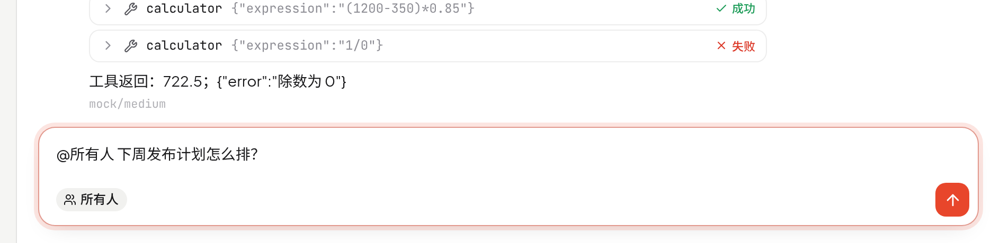
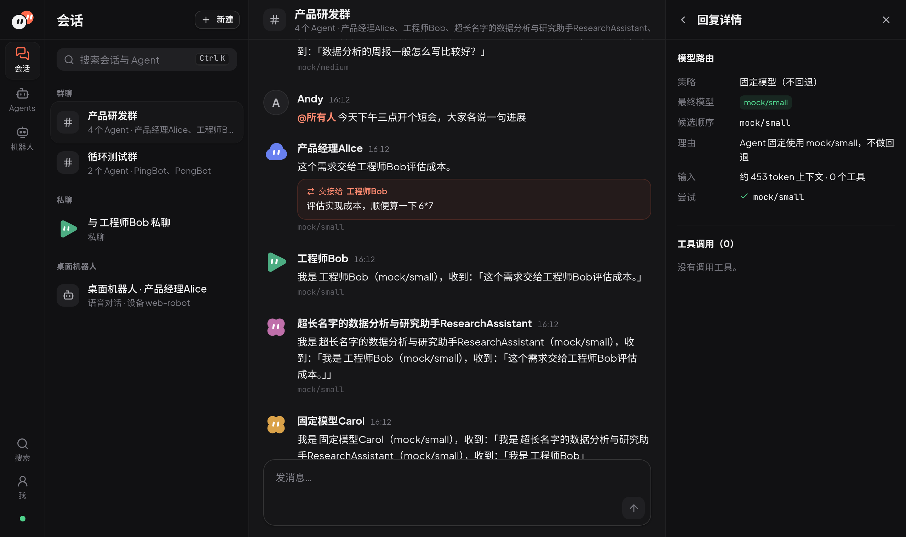
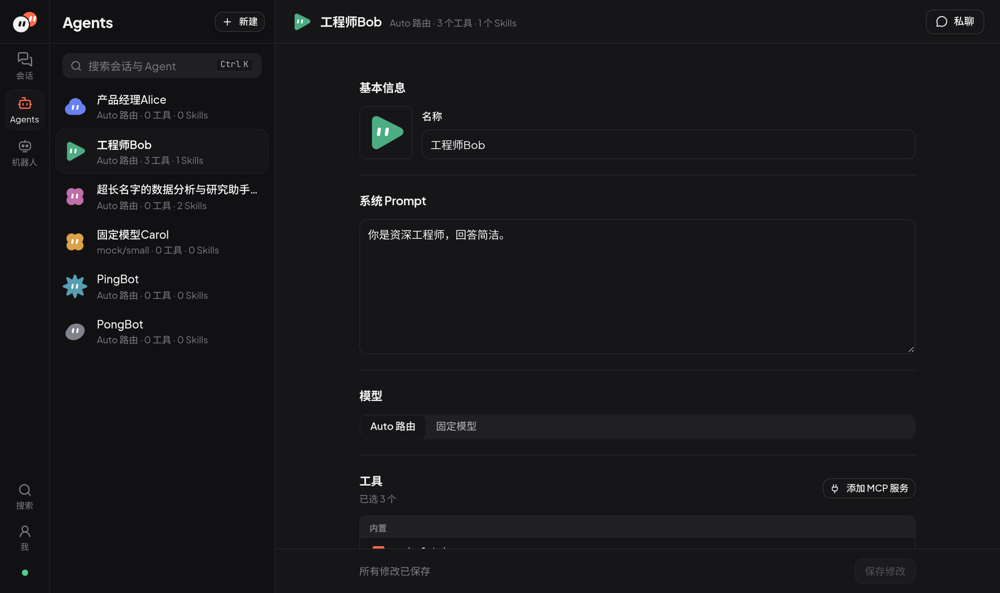

# 团团 Tuantuan

<picture>
  <source media="(prefers-color-scheme: dark)" srcset="docs/brand/tuantuan-lockup-dark.svg">
  
</picture>

**一群 Agent，团团协作。** 多 Agent 群聊工作台。

> 仓库已从 `bosshanz/agent-hub` 更名为 `bosshanz/tuantuan`（旧地址自动跳转）。为兼容，环境变量继续使用 `AGENT_HUB_*` 前缀，默认数据库路径仍是 `data/agent-hub.db`。

动态 Agent 平台：在网页上用 **Prompt + Tools + Skills** 组合出 Agent，后台按任务 **自动路由模型**，Agent 可以在 **群聊** 中被 @，也能通过 `handoff` 工具把任务交接给另一个 Agent。还带一个用语音对话的虚拟桌面机器人。


- 不需要任何 API Key 即可运行：默认使用内置的确定性 `mock` 模型。
- 接入真实模型只需在 `.env` 里填 1–5 个模型和对应的 Key（OpenAI 兼容接口：NewAPI、DeepSeek、通义千问、豆包等），不用改任何 JSON。

## 快速开始

需要 [Bun](https://bun.sh)（开发与测试使用 1.4.2；Skill 解析依赖内置的 `Bun.YAML`，更早版本未验证）。

```bash
git clone https://github.com/bosshanz/tuantuan.git
cd tuantuan
bun install
bun dev          # 同时启动 API（:8787）和前端（:5173），默认 mock 模型
```

打开 http://localhost:5173 ：

1. 左侧「Agents → + 新建」创建 Agent（名称用于 @，不能含空格）。
2. 「会话 → + 新建」建一个群聊并拉入 Agent，或与单个 Agent 私聊。
3. 在群聊里发消息，规则见下面的「群聊规则」。私聊里每条消息都交给该 Agent。
4. 点 Agent 回复下方的灰色小字（如 `按话题选中 · qwen/qwen-plus`），右侧面板会显示这条回复为什么是它回复、用了哪个模型、有没有回退、调用了哪些工具。

生产方式：`bun run build && bun start`（API 同时托管 `web/dist`，访问 http://localhost:8787）。

## 群聊规则

| 你发的消息 | 谁回复 |
| --- | --- |
| `@产品经理 …` | 只有被 @ 的 Agent（可以 @ 多个，按顺序各回复一次） |
| 不 @ 任何人 | 按话题自动选**一个**成员回复。选择链：决策模型 → LLM 分类模型 → 关键词规则 → 第一个成员；回复下方显示「按话题选中」 |
| `@所有人`（或 `@all` / `@everyone`） | 每个成员按成员顺序各回复一次 |
| 回复还没结束时又发了一条 | 立即打断当前回复（已生成的部分保留，标记「被新消息打断」），丢弃还没执行的交接，再处理新消息 |



- 输入框下方会实时显示这条消息将由谁回复（例如「回复 · 产品经理 · 工程师」「按话题自动选一位」「所有人 · 4」），回复进行中还会提示「发送会打断当前回复」。
- **Agent 之间的交接只能通过内置工具 `handoff(agent, task)`**。Agent 回复正文里写的 `@名字` 只是显示，不会触发对方。交接后对方接手并看到 task，界面上显示为一张「交接给 X」卡片，接手方的回复下方显示「接 X 的交接」。
- 每条人类消息引发的交接最多 `maxAgentHops` 次（默认 5），超出时停止并在会话里提示。
- 交接需要模型支持 function calling；不支持的模型会回退到下一个候选模型。



## 用 mock 演示

mock 模型根据文本中的指令给出确定性结果，方便不接 Key 就体验完整流程：

| 写在哪里 | 指令 | 效果 |
| --- | --- | --- |
| Agent 的系统 Prompt | `[[reply:好的]]` | 该 Agent 固定这样回复 |
| Agent 的系统 Prompt | `[[handoff:Bob 请你来处理]]` | 该 Agent 先调用 handoff 工具把任务交给 Bob（Agent 之间只能这样交接，回复里写 @ 不会触发） |
| 发送的消息 | `[[tool:calculator {"expression":"6*7"}]]` | 调用工具（需在 Agent 上勾选），再根据结果回复 |
| 发送的消息 | `[[tool:load_skill {"name":"code-review"}]]` | 按需加载 Skill 正文 |
| 发送的消息 | `[[fail:small]]` | 让 `mock/small` 模拟故障，观察路由回退（分类器也用 small，会退回规则分类） |

例：Prompt 分别为 `[[handoff:PongBot 该你了]]` 和 `[[handoff:PingBot 该你了]]` 的两个 Agent 会互相交接，直到触发跳数上限（默认 5）。

## 接入真实模型

### 只改 .env（推荐）

```bash
cp .env.example .env
```

最小示例（2 个模型 + 决策模型）：

```bash
AGENT_HUB_MODELS=deepseek/deepseek-chat,qwen/qwen-plus
DEEPSEEK_API_KEY=sk-...
DASHSCOPE_API_KEY=sk-...
# 可选：百炼决策模型做 Auto 路由分类
DECISION_BASE_URL=https://{WorkspaceId}.cn-beijing.maas.aliyuncs.com
```

接一个不在内置目录里的模型（例如经 NewAPI 中转的 gpt-4o，它在列表中是第 3 个，所以序号是 3）：

```bash
AGENT_HUB_MODELS=deepseek/deepseek-chat,qwen/qwen-plus,newapi/gpt-4o
NEWAPI_BASE_URL=https://your-newapi.example.com/v1
NEWAPI_API_KEY=sk-...
AGENT_HUB_MODEL_3_TAGS=chat,coding,vision
AGENT_HUB_MODEL_3_TIER=3
AGENT_HUB_MODEL_3_CONTEXT=128000
```

在 `.env` 里写 `AGENT_HUB_MODELS=provider/模型,...`（1–5 个），并填好对应 provider 的 `*_API_KEY`（以及 newapi 的 `NEWAPI_BASE_URL`），不需要 providers.json。可用的 provider 有 `newapi`、`deepseek`、`qwen`、`doubao`。

- 内置目录里已知的模型有 deepseek-chat、deepseek-reasoner、qwen-turbo、qwen-plus、qwen-max、qwen-long、qwen-vl-plus、doubao-seed-1-6-250615、doubao-seed-1-6-flash-250615，它们的标签、成本档和上下文长度都已预设。
- 其他模型需要在 `.env` 里写 `AGENT_HUB_MODEL_<序号>_TAGS / _TIER / _CONTEXT` 三项，序号从 1 开始。这三项也可以用来覆盖已知模型的预设值。
- 启动时会校验：数量必须在 1–5 之间、不能重复、provider 必须存在、Key 和地址必须齐全。出错时启动失败，并用中文指出是哪个变量有问题。
- `AGENT_HUB_CLASSIFIER_MODEL`（可选）：指定一个已启用的模型作为 LLM 分类器。
- 如果同时存在 providers.json，模型集合仍以 `AGENT_HUB_MODELS` 为准；providers.json 里的 provider 定义、模型元数据、router 和 limits 会被沿用。

### 决策模型（Auto 路由分类器，可选）

设置 `DECISION_BASE_URL=https://{WorkspaceId}.cn-beijing.maas.aliyuncs.com`（填业务空间地址，程序会自动拼接 `/compatible-mode/v1/systemone`；直接填完整 endpoint 也可以），就会启用百炼 `decision-model-preview` 来判断任务类型和难度。

- Key 用 `DECISION_API_KEY`，没填时用 `DASHSCOPE_API_KEY`。
- 其他可选项：`DECISION_MODEL`、`DECISION_MIN_CONFIDENCE`（默认 0.6）、`DECISION_TIMEOUT_MS`（默认 3000）。
- 调用失败、超时或返回格式不对时，按 LLM 分类器 → 规则 依次回退。某一项置信度太低时，只有这一项回退。
- 回复详情面板里会显示用了哪个分类器、各项置信度和回退原因。

### 分类器链（Auto 路由）

Auto 模式的 Agent 每次回复前先判断任务类型（chat / coding / reasoning / long_context / tool_heavy / vision）和难度（简单 / 中等 / 困难），再挑模型：

1. 决策模型（设置了 `DECISION_BASE_URL` 时）。
2. LLM 分类器（`AGENT_HUB_CLASSIFIER_MODEL` 或 providers.json 的 `router.classifierModel`）。
3. 规则分类（总是可用）。

上一级失败、超时或格式不对时整体换下一级；置信度低于 `DECISION_MIN_CONFIDENCE` 时只有这一项换下一级。然后按「具备该标签、上下文够用、成本档不低于该难度的最低档、最便宜优先」排出候选模型，依次调用，只有在模型输出任何内容之前失败才换下一个。群聊里不 @ 时选回复人也走同一条链（决策模型 → LLM → 关键词规则 → 第一个成员）。固定模型的 Agent 跳过分类，不回退。

### 使用 providers.json（进阶，可选）

需要自定义 provider、路由表（`router.minTier`）或限制（`limits`）时才需要它。

```bash
cp config/providers.example.json config/providers.json   # 已被 .gitignore 忽略
cp .env.example .env                                     # 填入对应的 API Key
```

`config/providers.json` 结构：

- `providers`：`{ id, type: "openai", baseUrl?, baseUrlEnv?, apiKeyEnv }`，Key 只通过环境变量名引用，文件里不放密钥；`type: "mock"` 为内置模型。
  - 地址解析顺序：`baseUrlEnv` 指向的环境变量非空时用它（必须是合法 http(s) URL，否则启动报错并指出变量名）→ 否则用 `baseUrl` → 两者都没有则启动报错并指出 provider。
  - 示例配置里每个 provider 都有 `*_BASE_URL`，所以日常只需改 `.env`；newapi 没有默认地址，必须填 `NEWAPI_BASE_URL`（不用的话从 providers.json 删掉它）。
  - 启动日志会列出所用配置文件，以及每个 provider 的地址来源和 Key 是否已设置。既没有 `AGENT_HUB_MODELS` 也没有 providers.json 时只用内置 mock（不会自动套用示例配置）。
- `models`：`{ id, provider, model, tags, costTier, contextWindow }`。`tags` 取值 `chat | coding | reasoning | long_context | tool_heavy | vision`；`costTier` 1（最便宜）~ 3（最强）。
- `router.classifierModel`：用于任务分类的便宜模型；省略则只用规则分类。`router.minTier`：各难度优先的最低成本档。
- `limits`：`maxAgentHops`（每条人类消息最多的 Agent 交接次数，默认 5）、`maxToolIterations`（默认 6）、`contextMessages` / `contextChars`（上下文窗口）。

文件不存在时使用内置 mock 配置；文件存在但不合法时启动直接报错，不会静默回退。

## 环境变量

见 `.env.example`：`PORT`、`DB_PATH`（默认 `data/agent-hub.db`）、`SKILLS_DIR`（默认 `skills`）、`AGENT_HUB_CONFIG`、`MOCK_CHUNK_DELAY_MS`，以及各 Provider 的 Key / BASE_URL、`AGENT_HUB_MODELS`、`AGENT_HUB_MODEL_<n>_*`、`AGENT_HUB_CLASSIFIER_MODEL`、`DECISION_*`。

## 界面



- 现代简洁风格：干净的中性底色（浅色近白 / 深色石墨），品牌色是 Logo 里的番茄珊瑚红，只用在关键动作和状态上；Agent 头像用鲜亮的彩色区分。字体为 Plus Jakarta Sans（已自托管）+ 苹方，浅色/深色跟随系统。
- Agent 头像是 SVG Bot（13 种轮廓 × 13 种颜色），默认按 Agent id 生成，在编辑页点击头像修改。头像会根据状态变表情（思考、说话、难过、惊讶、休眠），开启「减少动态效果」时静止。预览全部表情：`/#/dev/avatars`。

## 桌面机器人

左侧导航「机器人」（`#/robot`）打开虚拟桌面机器人：

- 先选要绑定的 Agent；脸部会显示待机、聆听、思考、说话、开心、难过/出错、惊讶等表情。
- 按住说话或打开免提（需要支持 Web Speech 的浏览器，推荐 Chrome；Safari 支持有限），回复用 zh-CN 朗读；不支持语音时用文字输入。说话时可以直接打断。
- Agent 用内置工具 `robot_express` / `robot_action` 控制表情和动作（点头、摇头、歪头、挥手、环顾、跳舞）。设备没确认（离线、超时、不支持）时工具会如实返回失败。
- 对话保存为聊天列表里「桌面机器人」分组下的会话，每个 Agent 一个（重复打开不会新增），也可以在网页里接着聊。
- mock 模型下说「你好」「跳舞」会触发对应的表情和动作。
- 真实硬件可按 [docs/device-protocol.md](docs/device-protocol.md) 接入。

## Skills

`skills/<名字>/SKILL.md`，YAML frontmatter 必须有 `name`（字母数字 `_-`）和 `description`。Agent 只在系统提示里看到名称和描述，需要时调用 `load_skill` 才注入正文。加载失败的 Skill 会在启动日志和 Agent 编辑页列出原因。

## 开发命令

```bash
bun run check      # tsc 类型检查 + biome lint + bun test
bun run test       # 仅测试
bun run build      # 构建前端
bun run e2e        # 浏览器冒烟 + 对齐断言（需先 build，需要本机 Chrome；CHROME_PATH 可指定）
```

## 常见问题

| 现象 | 原因与处理 |
| --- | --- |
| 启动失败并提示某个变量 | `.env` 校验没通过：模型数量不在 1–5、重复、provider 不存在、缺 Key 或 BASE_URL 不是合法 URL。按提示修改那个变量。 |
| 启动日志显示「使用内置 mock」 | 没设置 `AGENT_HUB_MODELS` 也没有 providers.json；或 `.env` 不在项目根目录（Bun 只自动读取当前目录的 `.env`）。 |
| Agent 列表 / 编辑页提示模型未启用 | 这个 Agent 固定了一个不在 `AGENT_HUB_MODELS` 里的模型。改成 Auto 或换一个已启用的模型。 |
| 回复下方显示「已回退」 | 前面的候选模型在输出前失败（HTTP 错误、缺 Key、超时）。点开详情看每次尝试的错误。 |
| 决策模型一直没生效 | 检查 `DECISION_BASE_URL` 是业务空间地址、Key 有权限；详情面板的「分类」会写明回退原因（超时、HTTP 状态、置信度不足）。 |
| 群里一句话好几个 Agent 都回复 | 只有 @ 多人、`@所有人` 或 Agent 调用了 `handoff` 才会这样。详情面板的工具调用里能看到 handoff。 |
| Agent 说「让 @X 来」但 X 没反应 | 正常：正文里的 @ 只是显示，交接必须调用 `handoff` 工具；模型要支持 function calling。 |
| 机器人不听 / 不说话 | 浏览器需要麦克风权限和 Web Speech 支持；不行就用文字输入。 |
| 机器人会话列表里有很多空的旧会话 | 旧版本每次打开都新建会话；升级后启动一次会自动清理（迁移 3）。 |
| e2e 找不到浏览器 | 设置 `CHROME_PATH` 指向本机 Chrome。 |

## 文档

- [docs/product.md](docs/product.md)：产品规则与验收条件
- [docs/architecture.md](docs/architecture.md)：模块、状态归属、路由机制与取舍
- [docs/device-protocol.md](docs/device-protocol.md)：桌面机器人 / 硬件设备的 WebSocket 协议


## License

MIT
