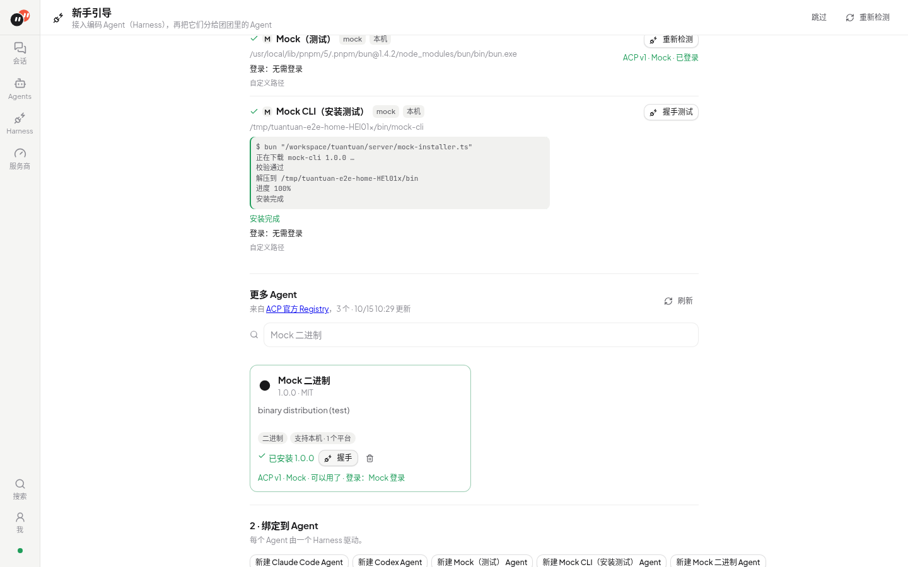
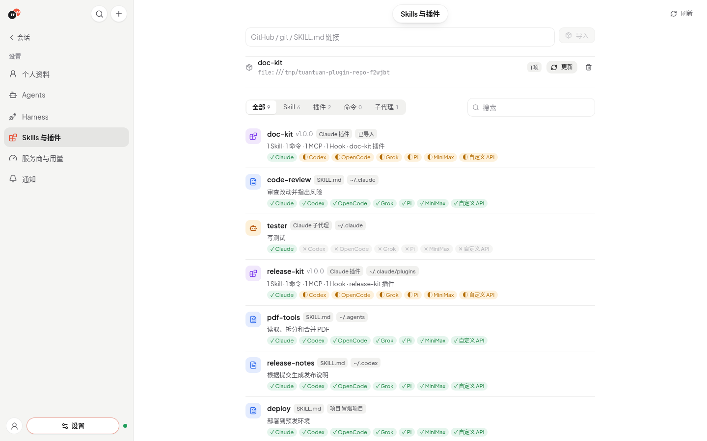

# 团团 Tuantuan

<picture>
  <source media="(prefers-color-scheme: dark)" srcset="docs/brand/tuantuan-lockup-dark.svg">
  
</picture>

**一群 Agent，团团协作。** 多 Agent 协作工作台。

> 仓库已从 `bosshanz/agent-hub` 更名为 `bosshanz/tuantuan`（旧地址自动跳转）。为兼容，环境变量继续使用 `AGENT_HUB_*` 前缀，默认数据库路径仍是 `data/agent-hub.db`。

团团不自带模型：每个 Agent 绑定一个编码 **Harness**（Claude Code、Codex、Grok Build、OpenCode、Pi、MiniMax Code，以及 [ACP Registry](https://agentclientprotocol.com) 里的其他 Agent），团团通过 ACP（Agent Client Protocol）驱动它。按 **项目**（名称 + 目录）组织 **会话**（1 个或多个 Agent）；多个 Agent 时可 @、设主 Agent、交接。完整显示流式回复、思考、工具调用（diff / 终端输出）、计划、权限请求和用量。


功能一览：

- **桌面版**（macOS / Windows / Linux，Electron）或浏览器 + 本机服务。
- **Harness**：自动发现你自己装的版本；没有时一键装到团团自己的目录（官方 ACP Registry，固定版本、校验和、不用 sudo）；握手测试与登录引导。
- **会话**：按项目分组；单 Agent 直接对话，多 Agent 支持 @、@所有人、主 Agent、`handoff` 交接和引用回复。侧栏随回复完成更新预览，断线重连后补齐。
- **项目终端**：会话右上角打开内嵌交互式终端（macOS / Linux），默认进入项目目录；支持 Ctrl+C、调整高度、平滑展开 / 收起及重连。每个项目复用一个 shell，收起不会结束命令；支持减少动态效果。
- **服务商与用量**：给 Claude Code / Codex / 自定义 API 配置服务商（Key 只在服务端、打码显示），只读导入 CC Switch，查看本机用量和余额。
- **Skills**：自动发现 `~/.agents`、`~/.claude`、`~/.codex`、插件和项目里的 Skills，按 Agent 勾选；可从链接或文件夹导入。
- **通知**：「通知」页提供主开关与回复完成、需要批准、出错、需要登录或 Key 的分类开关；测试发送与签名诊断已移除。看着当前会话时不提醒，其他会话保留未读计数。
- 模型、登录由 Harness 自己管理；团团从不改 `~/.claude` / `~/.codex`。
- 不装任何 CLI 也能体验：`TUANTUAN_MOCK_HARNESS=1` 启用内置 mock ACP agent。

## 快速开始

需要 [Bun](https://bun.sh)。CI 固定为 1.4.2；本轮本机在 1.3.14 上通过完整检查、构建与 Chrome 冒烟，见 [修复记录](docs/plan-harness-acp.md#2026-10-15-本机边界与状态恢复修复)。Skill 解析依赖内置的 `Bun.YAML`；其他版本未验证。

```bash
git clone https://github.com/bosshanz/tuantuan.git
cd tuantuan
bun install
bun dev          # 同时启动 API（:8787）和前端（:5173）
```

开发模式下 Vite 会把 `/api`、`/mcp` 和 `/ws` 转发到 API（列表在 `server/routes.ts`）。改了 `vite.config.ts` 或这个列表后要重启 `bun dev`。

打开 http://localhost:5173 ：

1. 首次启动是一页三步的引导（随时可「跳过」，只出现一次）：选一个 Harness（没装就一键安装）→ 需要时登录（Harness 自带登录按钮，或复制终端命令，回到窗口自动重新检测）→ 给第一个 Agent 起名，创建后直接在「草稿」里打开会话。之后在左侧「Harness」（`#/harness`）管理全部 Harness。

   

2. 「Agents → + 新建」创建 Agent：选 Harness、权限策略、身份文档、MCP 服务器和环境变量。
3. 「会话」侧栏按**项目**分组。先建项目（新建目录，或选择已有文件夹；根目录默认 `~/Tuantuan`，可用 `TUANTUAN_WORKSPACES` 改），再在项目下建会话。未选项目时进默认项目「草稿」（`~/Tuantuan/drafts`）。会话共用项目目录；2+ Agent 时可设**主 Agent**。更换项目目录会重置该项目下会话的 Harness 上下文。

生产方式：`bun run build && bun start`（API 同时托管 `web/dist`，访问 http://localhost:8787）。API 默认只监听 `127.0.0.1`；HTTP（含 MCP）与 WebSocket 升级均校验本机 Host、浏览器 Origin 和跨站请求标记，正常的本机 Vite 代理可用。原生本机客户端可省略 Origin。`TUANTUAN_HOST` 可改监听地址，但不会关闭请求检查，也不提供远程访问鉴权。

## 桌面版（Electron）

下载 Releases 里的安装包（macOS `.dmg`、Windows `.exe`、Linux `.AppImage`），打开即用：不用装 Bun，也不用开终端。数据在系统的应用数据目录（macOS `~/Library/Application Support/团团`，菜单「帮助 → 打开数据文件夹」），会话文件夹默认在 `~/Tuantuan`。Claude Code 和 Codex 默认不打进安装包（AppImage 约 157 MB），第一次用时在「Harness」页一键从 ACP Registry 下载；打包时设 `TUANTUAN_BUNDLE_ADAPTERS=1` 可改回内置（约 +300 MB）。你自己装的 Harness 和 CC Switch 设置的环境变量会从登录 shell 读到。


界面是单侧栏布局：侧栏顶部是搜索和「+」，下面是会话（大头像 + 最后一条消息），再下面是「项目」分组（可折叠，当前项目自动展开）；底部是你的头像和「设置」（Agents、Harness、服务商与用量都在这里）。主区顶部是居中的悬浮标题，点击打开右侧详情（详情 / 资料库 / 成员）。macOS 上窗口没有系统标题栏，红绿灯在侧栏顶行左侧，搜索和「+」在它右边；全屏时这块空位收回。


自己打包：

```bash
bun install && bun run desktop:install   # 第一次：装 Electron 和打包工具
bun run desktop:dev                      # 开发：构建前端后用 Electron 打开
bun run desktop:build                    # 当前系统、当前架构的安装包 → desktop/release/
bun run desktop:build -- --arch arm64,x64   # macOS 同时出 Apple 芯片和 Intel 包
xvfb-run -a bun run desktop:smoke        # Linux：无界面端到端冒烟
```

macOS 本机打 dmg：在 Mac 上执行上面前三行即可，得到 `desktop/release/Tuantuan-<版本>-mac-arm64.dmg`。没有证书时包是未签名的，第一次打开需要右键「打开」，或执行 `xattr -dr com.apple.quarantine /Applications/团团.app`。要签名公证，打包前设置 `CSC_LINK`、`CSC_KEY_PASSWORD`（Developer ID 证书）和 `APPLE_ID`、`APPLE_APP_SPECIFIC_PASSWORD`、`APPLE_TEAM_ID`；Windows 用 `WIN_CSC_LINK`、`WIN_CSC_KEY_PASSWORD`。自动更新默认关闭，打包时设 `TUANTUAN_PUBLISH=github` 和 `GH_TOKEN` 才会写入 GitHub Releases 更新源。GitHub Actions 的 Desktop 工作流（打 `v*` 标签或手动触发）会打出三个平台的包作为构建产物，不发布。

## 安装和登录 Harness

团团优先用你自己装的版本（登录 shell 的 PATH，或在「Harness」页填的绝对路径），这样会沿用你的版本和配置；找不到时用团团内置的（源码运行时）或团团从 ACP Registry 装的。「Harness」页会标出当前用的是「本机」「自定义路径」「内置」还是「团团安装」。桌面包默认不内置 Claude Code / Codex，下表「内置」一列指源码运行。

| Harness | 团团怎么提供 | 还需要什么 | 登录 |
| --- | --- | --- | --- |
| Claude Code | **内置**：`@agentclientprotocol/claude-agent-acp` 是团团的依赖，用团团自己的 bun 启动；它依赖的 Claude Agent SDK 按平台自带 Claude Code 可执行文件（macOS arm64/x64、Linux x64/arm64，含 musl） | 不需要另装 Claude Code 或 Node | 本机有 `claude` 就运行它完成 `/login`；没有时「Harness」页给出内置 Claude Code 的路径来登录；或设置 `ANTHROPIC_API_KEY`（CC Switch 写入的 `~/.claude/settings.json` 照常生效） |
| Codex | **内置**：`@agentclientprotocol/codex-acp`，它依赖的 `@openai/codex` 按平台自带 codex 可执行文件（macOS arm64/x64、Linux x64/arm64） | 不需要另装 Codex 或 Node | ACP 登录（ChatGPT）；或 `codex login`（没有全局 `codex` 时页面给出内置命令）；或 `OPENAI_API_KEY`。`~/.codex/config.toml` 照常生效 |
| Grok Build | **一键安装**：官方脚本 `curl -fsSL https://x.ai/cli/install.sh \| bash`（装到 `~/.grok/bin`，不需要 sudo） | curl、bash | `grok login`，或 `XAI_API_KEY` |
| OpenCode | **一键安装**：官方脚本（`~/.opencode/bin`）、`bun add -g opencode-ai`（`~/.bun/bin`）、Homebrew，或 npm（仅当全局目录可写） | 对应工具 | `opencode auth login`（自带免费模型时可不登录） |


一键安装只在你点按钮后运行官方安装命令：后台执行，日志实时显示，可取消，失败时显示最后一行错误，完成后自动重新检测。取消或超时会回收安装命令及其子进程组。不会用 sudo；某种方式在这台机器上不可用（没有 curl / brew，npm 全局目录需要 sudo）时按钮置灰并说明原因。都不可用时显示手动安装命令。

### ACP Registry 与「更多 Agent」

团团直接读取官方 [ACP Registry](https://cdn.agentclientprotocol.com/registry/v1/latest/registry.json)：启动时用本地缓存（没有缓存时用随包的快照，离线也能看），后台每 6 小时更新一次，「刷新」按钮立即更新；数据先过 schema 校验，坏条目跳过，更新失败保留旧数据并显示原因。图标从 Registry 下载后缓存在本地。

- 常用列表：Claude Code、Codex、Grok Build、OpenCode、Pi、MiniMax Code。「更多 Agent」列出 Registry 里所有 Agent（图标、名称、简介、版本、协议、平台），可搜索。
- 一键安装只在点按钮后执行，装到团团自己的目录（`<数据目录>/harnesses/agents/<id>/<版本>`，可用 `TUANTUAN_HARNESS_DIR` 改），固定版本，不用 sudo，不装全局：npx 包用团团自带的 Bun 安装运行；需要 Node ≥ 22 的（如 MiniMax Code）自动下载团团专用的 Node 22（校验 SHASUMS256）；uvx 包用你的 uv，没有就下载一份；二进制包按平台下载，带 sha256 时校验。
- Registry 的 Agent id、版本必须是安全的单个目录段；拒绝路径穿越和保留名称。二进制 / npx 安装先写入独立随机暂存目录，成功后更新版本目录与 manifest，失败或取消时清理暂存；uvx 因 venv 固定路径仍直接写目标版本目录，失败时清理该目录。
- Registry 版本变了显示「更新到 x」；可卸载团团装的版本。你自己装的版本始终优先（`TUANTUAN_PREFER_MANAGED=1` 反过来）。
- 装好的 Agent 可在新建 Agent 时选择；「握手」会显示它支持的登录方式（Harness 自带登录、终端命令、环境变量）。
- **API Key 登录**：Agent 通过 ACP 声明 `env_var` 登录方式（如 glm-acp-agent 的 `Z_AI_API_KEY`）时，握手结果里直接出现输入框：Key 保存在团团的数据库里（和服务商 Key 一样只在服务端、打码显示），只注入这个 Harness 的进程环境（Agent 自己的环境变量优先），保存后自动重新握手，可修改、清除。回复因为缺 Key 失败时，会话里显示「需要 API Key」并可当场填写。
- **终端登录**：终端类登录方式（ACP `terminal`，或说明里写着 `xxx --setup` 的）提供「在终端中打开」：用团团安装的绝对路径和运行时（如 `…/bun …/dist/index.js --setup`）打开 macOS「终端」（osascript）或 Linux 的终端程序；同时总有一行可复制的完整命令。团团不把它装进 PATH。
- 实验性：ZCode（社区桥接 `zcode-acp-server`，不在官方 Registry 里）。
- `TUANTUAN_REGISTRY_URL` 换 Registry 地址，`TUANTUAN_REGISTRY_OFFLINE=1` 不联网。



源码运行时的内置适配器体积：每个平台约 250 MB（Claude Code）+ 330–400 MB（Codex），`bun install` 只下载当前平台的那一份。

「Harness」页的「握手测试」会报告是否已登录。未登录时，如果 Harness 通过 ACP 声明了自带的登录流程（如 Codex 的 ChatGPT / API Key、Grok 的 grok.com、OpenCode 的 opencode-login），点「用「…」登录」由 Harness 自己完成（可能会打开浏览器），完成后自动重新检测；否则复制旁边的登录命令到终端执行，再点「重新检测」。所有 Agent 共用同一份 Harness 登录。

> Claude Code 的适配器没有声明登录方式，而且未登录时也能建会话，所以「已登录」只代表握手和建会话成功；真正发消息时没登录会提示去终端运行 `claude` 登录。

**身份文档**：每个 Agent 的身份文档保存在团团里，不写进你的仓库。Claude Code 通过 `_meta.systemPrompt.append`、Grok 通过 `_meta.rules`、Codex 通过进程环境 `CODEX_CONFIG` 的 `developer_instructions` 传递；其他 Harness 在会话第一条消息前附加。

## 会话规则

| 你发的消息 | 谁回复 |
| --- | --- |
| `@产品经理 …` | 只有被 @ 的 Agent（可以 @ 多个，不同 Agent 并行回复） |
| 不 @ 任何人 | 会话的**主 Agent**（仅 2+ Agent） |
| `@所有人`（或 `@all` / `@everyone`） | 每个成员各回复一次，不同 Agent 并行 |

- 会话里所有 Agent 共用项目目录。2+ Agent 时创建会话会选主 Agent。
- **会话转述**：Agent 收到截至本次请求的相关会话记录（最多 30 条、约 8000 字），当前任务的原始请求与引用单独附上。排队期间到来的新消息不会替换本次任务；交接额外包含本轮已完成回复。单 Agent 会话直接转发用户消息。
- **交接**：多 Agent 会话注入 `tuantuan` MCP（`handoff` / `list_members`）。调用 `handoff` 后对方接手；界面显示交接卡片。正文 `@名字` 不会触发。
  - 只能交给会话里其他成员；去重与 `@所有人` 轮次规则同前。
  - 每条人类消息最多 5 次交接；来源正常回复结束后，接手任务进入目标 Agent 的队列。
  - 传输：HTTP `/mcp/<token>` 或 stdio 中转（`server/mcp-shim.ts`）。
- **并行与停止**：同一会话内，不同 Agent 并行，同一 Agent 按入队顺序执行。新消息不自动打断；输入框上方列出运行、排队和交接中的任务，可分别停止。停止只取消选中任务及依赖它的后续交接，独立请求继续；也可只取消一项排队任务。队列保存在服务内存，刷新浏览器可恢复状态，服务重启后不自动重放未完成工作。

## 能力

- 流式回复、思考过程、工具卡片（文件 diff、终端输出）、计划清单、用量。
- 权限请求弹窗：允许一次 / 总是允许 / 拒绝。提交期间禁止重复操作，服务端确认成功后关闭；提交失败保留弹窗并提示重试，404（请求已失效）也会关闭。
- 经过团团 ACP `fs/*` 的文件路径按真实路径校验，拒绝工作目录外的目标与符号链接逃逸；新文件校验最近的现存父目录。ACP 终端只校验初始 `cwd`，命令仍以当前用户权限运行，可访问其他路径；Harness 自带工具也由其自身权限 / 沙箱控制。这里没有操作系统沙箱，不能将旧文档中的「文件读写和终端只能在项目目录内」理解为所有执行都被隔离。
- 慢历史快照不会覆盖期间收到的运行状态、会话与权限事件；切换会话后旧响应不进入新会话。
- 会话开始前可在输入框旁选**模型**（Harness 通过 ACP 声明的 model 选项；BYOK 可改会话级模型 ID）。多人会话按 Agent 分别记住。中途切换走 `set_config_option`。没有模型选项时不显示。
- Harness 提供的其他配置项（模式、推理强度等）和斜杠命令（输入 `/` 弹出）。
- 粘贴或拖入图片（Harness 支持时）、随时停止、会话列表（切换 / 恢复历史会话 / 新会话）。
- 切换到 Harness 里的历史会话时用 `session/load`，Harness 回放的历史中团团没显示过的轮次（按用户消息去重）以只读方式显示在消息列表顶部。

## 用 mock 演示

`TUANTUAN_MOCK_HARNESS=1 bun dev` 后可以选「Mock」Harness。它回复「收到：…」，并支持 `/plan`（计划）、`/edit`（权限请求 + diff）、`/run`（终端）、`/slow`（慢回复，用于测试停止）；多 Agent 会话里 `/handoff 名字 任务`、`/members`。

## 环境变量

见 `.env.example`：`PORT`、`TUANTUAN_HOST`（默认 `127.0.0.1`）、`DB_PATH`（默认 `data/agent-hub.db`）、`TUANTUAN_MOCK_HARNESS`。其他常用：`TUANTUAN_WORKSPACES`（项目根目录）、`TUANTUAN_HARNESS_DIR`（团团安装的 Harness）、`TUANTUAN_REGISTRY_URL` / `TUANTUAN_REGISTRY_OFFLINE`、`TUANTUAN_PREFER_MANAGED`、`TUANTUAN_NATIVE_PICKER=0`。

## 界面


- 现代简洁风格：干净的中性底色（浅色近白 / 深色石墨），品牌色是 Logo 里的番茄珊瑚红，只用在关键动作和状态上；Agent 头像用鲜亮的彩色区分。字体为 Plus Jakarta Sans（已自托管）+ 苹方，浅色/深色跟随系统。设置开关以当前主题强调色表示开启，关闭和禁用使用中性灰，滑块在深浅主题下均保持清晰。
- Agent 头像是 SVG Bot（16 种轮廓（含小猫、小狗、兔子）× 13 种颜色），默认按 Agent id 生成，在编辑页点击头像修改。头像会根据状态变表情（思考、说话、难过、惊讶、休眠），开启「减少动态效果」时静止。预览全部表情：`/#/dev/avatars`。

## 开发命令

```bash
bun run check      # tsc 类型检查 + biome lint + bun test
bun run test       # 仅测试
bun run build      # 构建前端
bun run e2e        # 浏览器冒烟 + 对齐断言（需先 build，需要本机 Chrome；CHROME_PATH 可指定）
```

浏览器冒烟可用 `SHOTS_DIR=/tmp/tuantuan-shots` 保存截图；加上 `TERMINAL_VIDEO_DIR=/tmp/tuantuan-shots` 会保存终端动效录像 `project-terminal-motion.webm`，便于按原速检查展开、收起与快速反向操作。

## 自定义 API（BYOK）


新建 Agent 时 Harness 选「自定义 API（BYOK）」：接口格式（OpenAI Chat Completions / OpenAI Responses / Anthropic Messages）、Base URL、API Key、模型，可点「测试连接」。

- 团团内置的轻量 harness，只做对话：SSE 流式、身份文档作系统提示、会话转述；多 Agent 时 `handoff` / `list_members` 以原生 function/tool call 提供（与 MCP 走同一处理逻辑）。**没有文件读写和终端。**
- API Key 以明文保存在服务端 SQLite，专用接口只返回掩码（如 `sk-••••abcd`），不写日志；编辑时留空即保持原 Key。服务商 Key、管理 Key 与 Harness `env_var` 登录 Key 也保存在同一数据库；打码不代表磁盘加密。Harness 原生登录态仍由 Harness 管理。普通 Agent 环境变量属于可读写配置，不能视为专用密钥存储。系统钥匙串集成仍未实现。

## 会话设置（模型 / 权限 / 推理…）

Harness 通过 ACP `configOptions`（及旧的 `modes`）提供设置。输入框底栏优先显示**模型、权限、推理**这些常用入口，带图标、简短中文名和当前值，比如 `权限 询问`、`推理 高`；思考、协作、快速模式等其余选项统一放在「更多设置」。点开后列出选项名和 Harness 自己的说明。已知的 id/category（mode、model、effort/thought_level、thinking、collaboration_mode、fast-mode 等）会翻译成中文，其余沿用 Harness 给的名称。危险选项（Bypass permissions、full-access 等）用浅橙色标出。窗口较窄时，次要入口继续收进「更多设置」。多 Agent 会话只显示一个「各自设置」标签，点开后按 Agent 分组。

弹层渲染在 `<body>` 下，跟随触发按钮定位：默认向上展开，空间不够时向下，不超出窗口。

**Agent 默认设置**：在 Agent 页选好 Harness 后，团团会在临时目录开一个一次性 ACP 会话来读取可用选项（按 Harness 缓存 30 分钟）。读不到时（例如未登录）会显示原因和「重试」按钮。新会话按「会话里改过的 > Agent 默认 > Harness 默认」依次生效。

**卡住与停止**：`session/resume` / `load` 超过 45 秒会改开新会话；切换设置超过 20 秒算失败，Harness 拒绝时会直接显示它返回的原因。初始化会话期间点「停止」会立即停止等待，不再发送该任务的 prompt；已发出 prompt 时先发 `session/cancel`，默认 4 秒内仍未结束则强制终止该会话中该 Agent 的 Harness 及其 ACP 终端进程组，保留已生成内容。进程按会话与 Agent 隔离，强制取消不影响其他会话；同一 Agent 的下一项独立任务等待取消完成后执行，必要时重建 / 恢复会话。回复期间切换 ACP 历史会话会提示先停止当前任务。Agent 设置、项目目录或会话选择变更后，旧的初始化结果不会重新挂回。回复 15 秒还没有任何输出时，会显示等了多久。

## Skills 与插件

设置里的「Skills 与插件」是团团统一的库：

- **本机（只读）**：`~/.claude`（skills、commands、agents、plugins 里的市场 / 已安装插件）、`~/.agents/skills`、`~/.codex`（skills、prompts）、每个项目的 `.claude` / `.agents`。显示来源和格式，团团从不写这些目录。
- **导入**：粘贴 GitHub / git / SKILL.md 链接，复制到团团自己的目录（`<data>/library`），可更新、删除。
- **插件**：Claude 插件格式（`.claude-plugin/plugin.json`，含 skills、commands、agents、MCP、hooks），显示各部分数量和每个 Harness 的支持情况。
- **按 Agent 勾选**：Agent 编辑页「Skills 与插件」里搜索、勾选；新会话只加载勾选的：Claude Code 通过 `_meta.claudeCode.options.plugins` 加载整个插件（只对这个会话生效）；其他 Harness 拿到插件里的 Skill（链接到会话目录的 skills 目录，不覆盖同名）和 stdio MCP 服务器（ACP `mcpServers`）。

| | Skill | 命令 | 子代理 | MCP | Hook |
| --- | --- | --- | --- | --- | --- |
| Claude Code | ✓ | ✓ | ✓ | ✓ | ✓ |
| Codex、OpenCode、Grok、Pi、MiniMax | ✓ | ✕ | ✕ | ✓ 仅 stdio | ✕ |
| 自定义 API | ✓（load_skill） | ✕ | ✕ | ✕ | ✕ |

Codex 的 `~/.codex/prompts` 只有 Codex 自己会读。



## 服务商与用量

左侧「服务商」页保存可复用的 API 服务商（名称、图标、Claude Code 地址、OpenAI 兼容地址、Key、主模型 / 快速模型、接口格式）。预设：Anthropic、OpenAI、xAI Grok、DeepSeek、Kimi、智谱 GLM、通义千问、MiniMax、硅基流动、OpenRouter、自定义。每个服务商可以「测速」（带 Key 请求 `/models`，显示延迟）、查「余额」（只有公开接口的才有），并用「切换 Agent」一键改用它。

Agent 页的「服务商」默认是 **本机配置**：完全沿用你自己的登录、CC Switch 和环境变量。选了服务商后只影响这个 Agent 的 Harness 进程：

- Claude Code：进程环境里设置 `ANTHROPIC_BASE_URL` / `ANTHROPIC_AUTH_TOKEN` / `ANTHROPIC_MODEL` / `ANTHROPIC_DEFAULT_*_MODEL`，并去掉继承来的其它 `ANTHROPIC_*`。
- Codex：初始化后通过 ACP `providers/set` 指定地址和 Key（只在进程内存里，不需要 `codex login`）；模型合并进 `CODEX_CONFIG`（保留 developer_instructions）。codex-acp 只支持 Responses 接口，所以只有「接口格式 = Responses」的服务商可选。
- 自定义 API（BYOK）：直接用服务商的地址和 Key。

团团从不写 `~/.claude`、`~/.codex`。Key 只存在团团数据库里，接口和页面只返回打码后的 `sk-••••1234`。编辑服务商后，用它的 Agent 下一轮会自动重启进程用上新设置；删除后这些 Agent 回到「本机配置」。

**从 CC Switch 导入**：点按钮后才去只读打开 `~/.cc-switch/cc-switch.db`（旧版为 `config.json`），列出 Claude / Codex 的配置，勾选后导入，不会修改 CC Switch。

**Token 统计**（页面最上方）：每轮回复结束时，团团记下 Harness 自己报告的 Token（ACP `PromptResponse.usage`，Grok 的 `_meta.usage`），连同 Agent、模型（`_meta.quota.model_usage` / `_claude/model` / 当前模型选项）、Harness、服务商、会话和时间存进本地数据库；费用只在 Harness 通过 `usage_update` 报告累计费用时按轮差分记录。从不估算：没报告的 Harness 显示「无数据」。可按 Agent / 模型 / Harness 分组（排名 + 输入 / 输出 / 缓存条形），看每日趋势，范围选今天 / 7 天 / 30 天 / 全部。

| Harness | Token | 模型 | 费用 |
| --- | --- | --- | --- |
| Claude Code | ✓ 每轮（含缓存读写） | ✓ | ✓ 累计费用差分 |
| Codex | ✓ 每轮（含缓存、思考） | ✓ | — |
| OpenCode | ✓ 每轮（含缓存、思考） | 当前模型选项 | ✓ 累计费用差分 |
| Grok Build | ✓ `_meta.usage` | 当前模型选项 | — |
| Pi | 无数据（只报告上下文占用） | — | — |
| MiniMax Code、自定义 API、Registry 其他 Agent | 报告了就记，否则无数据 | | |


**额度**（同一页，支持查询的 Harness 各有卡片，可单独刷新）：

| 来源 | 内容 | 说明 |
| --- | --- | --- |
| Claude Code 本机记录 `~/.claude/projects/**/*.jsonl` | 今天 / 7 天 token | 与 ccusage 相同：按 message id + request id 去重 |
| Claude Code `/usage`（点刷新） | 5 小时 / 每周额度、重置时间、套餐 | 由 claude-agent-acp 自己查询；只用 API Key 时没有额度信息 |
| Codex 本机记录 `~/.codex/sessions/**/rollout-*.jsonl` | token、`rate_limits`（5 小时 / 每周）、套餐 | 取最新一条 `token_count` |
| Codex `/status`（点刷新） | 额度 | 需要已 `codex login` |
| Grok：官方 `grok usage <session-id>` | 今天 / 7 天 token、今天花费（有价格时） | 只查最近 7 天动过的会话 |
| Grok ACP `x.ai/billing` 扩展（点刷新） | 周期额度、重置时间、套餐、预付余额 | 沿用 Grok 自己的登录；只握手和查询，不创建会话、不发模型请求；旧版本不支持时提示更新 |
| Grok 每轮 ACP 返回的 `_meta.usage` | 计入「团团今天」 | |
| 余额：xAI `GET /v1/api-key`（检查 Key / 团队是否被停用，拿 team_id）+ Management API `GET /v1/billing/teams/{team_id}/prepaid/balance`（需另填 Management Key） | 预付余额（美元） | 没填 Management Key 时只显示 Key 状态 |
| 余额：DeepSeek `/user/balance`、OpenRouter `/api/v1/credits`、Kimi `/v1/users/me/balance`、硅基流动 `/v1/user/info` | 余额 | 其它服务商显示「没有公开的余额接口」 |
| 团团自己 | 今天每个 Harness / 服务商的轮数和 token | 来自每轮 ACP `session/prompt` 返回的 `usage` |

不读钥匙串、不拿 OAuth token 调私有接口。


Claude Code 用服务商时：Claude Code 会让 `~/.claude/settings.json` 里的 `env` 盖过进程环境变量，所以团团把服务商的地址、Key 和 `ANTHROPIC_MODEL` / `ANTHROPIC_DEFAULT_{OPUS,SONNET,HAIKU}_MODEL` 通过会话的 `_meta.claudeCode.options.settings`（比用户设置优先级更高的程序设置层）传入，不写任何用户文件。Agent 的「默认设置」按 Harness + 服务商分别读取，模型列表是服务商的模型，可填自定义模型 ID；切换服务商会清掉旧的默认模型。


## 选择文件夹

浏览器拿不到绝对路径，所以由服务端弹系统对话框：macOS 用 `osascript choose folder`，Linux 桌面用 `zenity` / `kdialog`。都不可用时（或 `TUANTUAN_NATIVE_PICKER=0`）改用应用内的文件夹浏览器（面包屑、常用目录、最近项目、git 仓库标记）。接口统一为 `POST /api/fs/pick`、`GET /api/fs/dirs`、`GET /api/fs/places`；桌面壳可通过 `setNativePicker()` 换成自己的原生对话框。新建项目、项目设置、Skill 导入都用它。


## Skills

每个 Agent 有自己的 Skills，按通用约定存放：`skills/<name>/SKILL.md`（frontmatter `name` / `description`，可带附属文件），兼容旧的 `commands/*.md`。

Agent 页「Skills」是一张勾选清单（新建 Agent 时就能勾选，保存后生效），自动列出：

- 用户级：`~/.agents/skills`、`~/.claude/skills`、`~/.codex/skills`，以及 `~/.claude/plugins/**/skills`（插件名取自 `.claude-plugin/plugin.json`）；
- 项目级：右上角选中项目的 `.agents/skills`、`.claude/skills`；
- 已导入到该 Agent 的 Skills。

勾选即对这个 Agent 启用（只记录路径到 `<数据目录>/agents/<id>/skills-linked.json`，不复制）。Harness 本来就会读取的位置（如 Claude Code 的 `~/.claude/skills`）显示为已勾选且不可取消——要停用请改用户自己的配置。

「从链接添加」支持 GitHub 仓库 / `tree` 链接（下载 tarball）、原始 `SKILL.md` 链接、任意 git 地址（`git clone --depth 1`）：先列出找到的 SKILL.md，勾选后复制到该 Agent。「文件夹」用文件夹选择器导入本地目录。


会话开始时，启用的 Skills 以符号链接放进会话目录里该 Harness 原生扫描的位置（同名已存在则跳过，不覆盖）：

| Harness | 位置 | 方式 |
| --- | --- | --- |
| Claude Code | `<会话目录>/.claude/skills` | 原生 |
| Codex | `<会话目录>/.agents/skills` | 原生（`$` 调用） |
| OpenCode | `<会话目录>/.agents/skills` | 原生 |
| Grok Build | `<会话目录>/.agents/skills` | 未见官方说明，按通用约定 |
| 自定义 API | 不写文件 | 模拟：系统提示列出名称和描述，`load_skill` 工具按需加载正文 |

不改 `CLAUDE_CONFIG_DIR` / `CODEX_HOME` / `XDG_CONFIG_HOME`：它们同时存放 Harness 的登录信息，隔离会导致需要重新登录。会话目录里已有的 `.claude/` / `.agents/` / `.opencode/` Skills 也会被发现。

输入框里 `/` 弹出 Harness 通过 ACP `available_commands_update` 提供的命令；`$` 显示当前会话收到的完整 Skill 清单，可滚动浏览，并按名称或描述关键词搜索（名称前缀优先，也能匹配插件名称中的片段）。正文空白后也可输入 `$`，补全时保留前后文；金额和 Markdown 代码中的 `$` 不触发补全。方向键可遍历全部结果，Tab / Enter 选择，Esc 关闭并保留草稿。清单不因补全而启用其他目录或插件中的 Skill，Harness 实际可用范围仍由其会话和配置决定。


### ACP 能力对照（各 Harness）

输入框：`/` 弹出 `available_commands_update` 里的命令；`$` 弹出 Skills（Codex 会把 skill 以 `$name` 形式放进同一列表，团团会拆开）。

| | Claude Code | Codex | OpenCode | Grok | 自定义 API |
| --- | --- | --- | --- | --- | --- |
| Skills 发现 | `<cwd>/.claude/skills` | `<cwd>/.agents/skills`、`~/.agents/skills` | `.agents` / `.claude` / `.opencode` | 未见文档，按 `.agents/skills` | `load_skill` 工具（模拟） |
| `/` 命令 | 原生（含 skill 名） | 原生（`/skills`、`/review`…） | 原生 | 需登录 | 无 |
| `$` Skills | 无（skill 走 `/`） | 原生（`$demo`…） | 无（skill 走 `/` 或 `@`） | — | 无（用工具） |
| 会话 list/resume/fork | 有 | 有 | 有 | 视登录 | 无 |
| configOptions | mode/model/effort… | mode/collaboration_mode/model | model/mode | — | 无 |
| 未接进 UI | providers、additionalDirectories、subagents、elicitation 表单、session.compaction | 同上；`/review-branch` 等已在命令列表可选 | MCP sse、自定义 skill tool 的单独面板 | 登录后能力未探 | 文件/终端 |

**用户本地配置（CC Switch / Codex provider）**：团团**从不**设置 `CLAUDE_CONFIG_DIR` / `CODEX_HOME` / `XDG_CONFIG_HOME`。Skill 只链到会话目录；进程继承登录 shell 的 `ANTHROPIC_*` / `OPENAI_*`；`CODEX_CONFIG` 只合并 `developer_instructions`，不覆盖 `model_provider`。

## 常见问题

| 现象 | 原因与处理 |
| --- | --- |
| 「Harness」页显示未安装 | 在终端里 `which <命令>` 确认已安装；GUI 启动时找不到的话，在「Harness」页填绝对路径。 |
| 发消息后提示 Authentication required | 该 Harness 没登录：按「Harness」页的登录方式在终端登录后重试。 |
| Agent 想改文件但没反应 | 查看权限弹窗；提交失败可原地重试。经团团 ACP 文件接口访问的目录外路径会被拒绝。 |
| e2e 找不到浏览器 | 设置 `CHROME_PATH` 指向本机 Chrome。 |

## 文档

- [docs/product.md](docs/product.md)：产品规则与验收条件
- [docs/architecture.md](docs/architecture.md)：模块、状态归属、路由机制与取舍
- [docs/plan-harness-acp.md](docs/plan-harness-acp.md)：ACP 改造计划、里程碑状态与决策记录


## License

MIT
