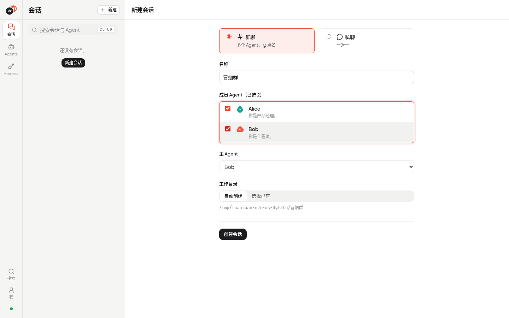
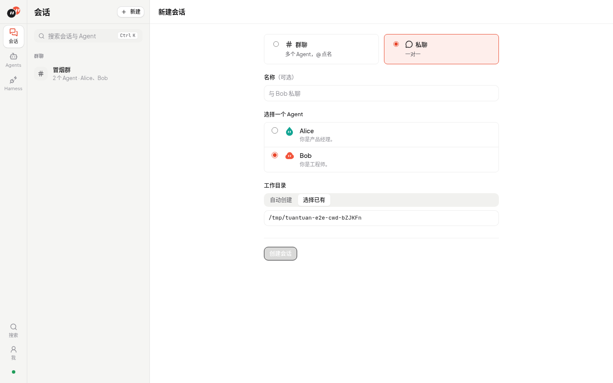

# 团团 Tuantuan

<picture>
  <source media="(prefers-color-scheme: dark)" srcset="docs/brand/tuantuan-lockup-dark.svg">
  
</picture>

**一群 Agent，团团协作。** 多 Agent 群聊工作台。

> 仓库已从 `bosshanz/agent-hub` 更名为 `bosshanz/tuantuan`（旧地址自动跳转）。为兼容，环境变量继续使用 `AGENT_HUB_*` 前缀，默认数据库路径仍是 `data/agent-hub.db`。

团团不自带模型：每个 Agent 绑定一个本机的编码 **Harness**（Claude Code、Codex、Grok Build、OpenCode），团团通过 [ACP（Agent Client Protocol）](https://agentclientprotocol.com) 驱动它。Agent 可以在 **群聊** 中被 @，也可以私聊，完整显示流式回复、思考、工具调用（diff / 终端输出）、计划、权限请求和用量。


- 模型、Key 和登录全部由 Harness 自己管理，团团不保存任何凭据。
- 不装任何 CLI 也能体验：`TUANTUAN_MOCK_HARNESS=1` 启用内置 mock ACP agent。

## 快速开始

需要 [Bun](https://bun.sh)（开发与测试使用 1.4.2；Skill 解析依赖内置的 `Bun.YAML`，更早版本未验证）。

```bash
git clone https://github.com/bosshanz/tuantuan.git
cd tuantuan
bun install
bun dev          # 同时启动 API（:8787）和前端（:5173）
```

开发模式下 Vite 会把 `/api`、`/mcp` 和 `/ws` 转发到 API（列表在 `server/routes.ts`）。改了 `vite.config.ts` 或这个列表后要重启 `bun dev`。

打开 http://localhost:5173 ：

1. 首次启动自动打开「新手引导」（只出现一次，完成或跳过后记在数据库里）；之后在左侧「Harness」（`#/harness`）管理：检测本机已安装的 Harness，显示版本、安装命令和登录方式，可以填绝对路径覆盖、点「测试」做 ACP 握手。
2. 「Agents → + 新建」创建 Agent：选 Harness、权限策略、身份文档、MCP 服务器和环境变量。
3. 「会话 → + 新建」建群聊或私聊。每个会话有自己的**工作目录**：默认自动创建：私聊 `~/Tuantuan/dm/<Agent 名>`，群聊 `~/Tuantuan/groups/<群名>`（环境变量 `TUANTUAN_WORKSPACES` 可改根目录），也可选已有文件夹；之后在详情面板修改。群聊还可设**主 Agent**。

生产方式：`bun run build && bun start`（API 同时托管 `web/dist`，访问 http://localhost:8787）。

## 安装和登录 Harness

团团从你的登录 shell 读取 PATH（桌面应用也能找到 npm / brew / curl 装的命令），也可以在「Harness」页给每个 Harness 填绝对路径。

| Harness | 安装 | 登录 |
| --- | --- | --- |
| Claude Code | `npm i -g @anthropic-ai/claude-code @agentclientprotocol/claude-agent-acp` | 运行 `claude` 完成 `/login`，或设置 `ANTHROPIC_API_KEY` |
| Codex | `npm i -g @openai/codex @agentclientprotocol/codex-acp` | `codex login`（ChatGPT 账号），或设置 `OPENAI_API_KEY` |
| Grok Build | `curl -fsSL https://x.ai/cli/install.sh \| bash` | `grok login`，或设置 `XAI_API_KEY` |
| OpenCode | `npm i -g opencode-ai` 或 `brew install anomalyco/tap/opencode` | `opencode auth login`（自带免费模型时可不登录） |

「Harness」页的「握手测试」会报告是否已登录。未登录时，如果 Harness 通过 ACP 声明了自带的登录流程（如 Codex 的 ChatGPT / API Key、Grok 的 grok.com、OpenCode 的 opencode-login），点「用「…」登录」由 Harness 自己完成（可能会打开浏览器），完成后自动重新检测；否则复制旁边的登录命令到终端执行，再点「重新检测」。所有 Agent 共用同一份 Harness 登录。

> Claude Code 的适配器没有声明登录方式，而且未登录时也能建会话，所以「已登录」只代表握手和建会话成功；真正发消息时没登录会提示去终端运行 `claude` 登录。

**身份文档**：每个 Agent 的身份文档保存在团团里，不写进你的仓库。Claude Code 通过 `_meta.systemPrompt.append`、Grok 通过 `_meta.rules`、Codex 通过进程环境 `CODEX_CONFIG` 的 `developer_instructions` 传递；其他 Harness 在会话第一条消息前附加。

## 群聊规则

| 你发的消息 | 谁回复 |
| --- | --- |
| `@产品经理 …` | 只有被 @ 的 Agent（可以 @ 多个，按顺序各回复一次） |
| 不 @ 任何人 | 群的**主 Agent** |
| `@所有人`（或 `@all` / `@everyone`） | 每个成员按顺序各回复一次 |

- 建群时选择主 Agent；群里所有 Agent 在群的工作目录里工作。
- **群聊转述**：Agent 每次被叫到时，收到的是它上次发言之后群里的新消息（最多 30 条、约 8000 字，超出时保留最新的并注明省略了几条）。
- **交接**：团团给群里每个 Agent 的会话注入一个名为 `tuantuan` 的 MCP 服务器，提供 `handoff(agent, task)` 和 `list_members`。Agent 调用 `handoff` 后，对方在这条回复结束后接手并收到 task；界面上显示「交接给 @X」卡片，接手方显示「接 @Y 的交接」。正文里写 `@名字` 不会触发对方。
  - 只能交给群里的其他成员；同一条消息里已在排队的不重复触发；`@所有人` 这一轮已经回复过的不会再被交接触发。
  - 每条人类消息最多 5 次交接，超出时停止并提示。新消息会打断当前回复并丢弃未执行的交接。
  - 传输：Harness 声明支持 HTTP MCP 时直接连团团的 `/mcp/<token>`，否则用 stdio 中转（`server/mcp-shim.ts`）。token 随机生成、只在内存里，每个「会话 + Agent」一个。

## 私聊

- 流式回复、思考过程、工具卡片（文件 diff、终端输出）、计划清单、用量。
- 权限请求弹窗：允许一次 / 总是允许 / 拒绝。文件读写和终端只能在会话的工作目录内。
- Harness 提供的配置项（模式、模型、推理强度等）和斜杠命令（输入 `/` 弹出）。
- 粘贴或拖入图片（Harness 支持时）、随时停止、会话列表（切换 / 恢复历史会话 / 新会话）。
- 切换到 Harness 里的历史会话时用 `session/load`，Harness 回放的历史中团团没显示过的轮次（按用户消息去重）以只读方式显示在消息列表顶部。

## 用 mock 演示

`TUANTUAN_MOCK_HARNESS=1 bun dev` 后可以选「Mock」Harness。它回复「收到：…」，并支持 `/plan`（计划）、`/edit`（权限请求 + diff）、`/run`（终端）、`/slow`（慢回复，用于测试停止）；群聊里 `/handoff 名字 任务`、`/members`。

## 环境变量

见 `.env.example`：`PORT`、`DB_PATH`（默认 `data/agent-hub.db`）、`TUANTUAN_MOCK_HARNESS`。旧版的 `AGENT_HUB_MODELS`、`DECISION_*` 和各 provider Key 已不再使用（模型由 Harness 管理）。

## 界面






- 现代简洁风格：干净的中性底色（浅色近白 / 深色石墨），品牌色是 Logo 里的番茄珊瑚红，只用在关键动作和状态上；Agent 头像用鲜亮的彩色区分。字体为 Plus Jakarta Sans（已自托管）+ 苹方，浅色/深色跟随系统。
- Agent 头像是 SVG Bot（13 种轮廓 × 13 种颜色），默认按 Agent id 生成，在编辑页点击头像修改。头像会根据状态变表情（思考、说话、难过、惊讶、休眠），开启「减少动态效果」时静止。预览全部表情：`/#/dev/avatars`。

## 开发命令

```bash
bun run check      # tsc 类型检查 + biome lint + bun test
bun run test       # 仅测试
bun run build      # 构建前端
bun run e2e        # 浏览器冒烟 + 对齐断言（需先 build，需要本机 Chrome；CHROME_PATH 可指定）
```


## 自定义 API（BYOK）


新建 Agent 时 Harness 选「自定义 API（BYOK）」：接口格式（OpenAI Chat Completions / OpenAI Responses / Anthropic Messages）、Base URL、API Key、模型，可点「测试连接」。

- 团团内置的轻量 harness，只做对话：SSE 流式、身份文档作系统提示、群聊转述；群里的 `handoff` / `list_members` 以原生 function/tool call 提供（与 MCP 走同一处理逻辑）。**没有文件读写和终端。**
- API Key 只存服务端（SQLite），接口只返回掩码（如 `sk-••••abcd`），不写日志；编辑时留空即保持原 Key。

## Skills

每个 Agent 有自己的 Skills，按通用约定存放：`skills/<name>/SKILL.md`（frontmatter `name` / `description`，可带附属文件），兼容旧的 `commands/*.md`。在 Agent 页「Skills」里可从 `.claude` / `.agents` / 插件目录（含 `.claude-plugin/plugin.json` 的根目录）或 git 地址导入，逐个启用/停用。

会话开始时，启用的 Skills 以符号链接放进会话目录里该 Harness 原生扫描的位置（同名已存在则跳过，不覆盖）：

| Harness | 位置 | 方式 |
| --- | --- | --- |
| Claude Code | `<会话目录>/.claude/skills` | 原生 |
| Codex | `<会话目录>/.agents/skills` | 原生（`$` 调用） |
| OpenCode | `<会话目录>/.agents/skills` | 原生 |
| Grok Build | `<会话目录>/.agents/skills` | 未见官方说明，按通用约定 |
| 自定义 API | 不写文件 | 模拟：系统提示列出名称和描述，`load_skill` 工具按需加载正文 |

不改 `CLAUDE_CONFIG_DIR` / `CODEX_HOME` / `XDG_CONFIG_HOME`：它们同时存放 Harness 的登录信息，隔离会导致需要重新登录。会话目录里已有的 `.claude/` / `.agents/` / `.opencode/` Skills 也会被发现。

输入框里 `/` 弹出 Harness 通过 ACP `available_commands_update` 提供的命令，`$` 弹出 Skills；方向键选择，Tab / Enter 补全，Esc 关闭。


### ACP 能力对照（各 Harness）

输入框：`/` 弹出 `available_commands_update` 里的命令；`$` 弹出 Skills（Codex 会把 skill 以 `$name` 形式放进同一列表，团团会拆开）。

| | Claude Code | Codex | OpenCode | Grok | 自定义 API |
| --- | --- | --- | --- | --- | --- |
| Skills 发现 | `<cwd>/.claude/skills` | `<cwd>/.agents/skills`、`~/.agents/skills` | `.agents` / `.claude` / `.opencode` | 未见文档，按 `.agents/skills` | `load_skill` 工具（模拟） |
| `/` 命令 | 原生（含 skill 名） | 原生（`/skills`、`/review`…） | 原生 | 需登录 | 无 |
| `$` Skills | 无（skill 走 `/`） | 原生（`$demo`…） | 无（skill 走 `/` 或 `@`） | — | 无（用工具） |
| 会话 list/resume/fork | 有 | 有 | 有 | 视登录 | 无 |
| configOptions | mode/model/effort… | mode/collaboration_mode/model | model/mode | — | 无 |
| 未接进 UI | providers、additionalDirectories、subagents、elicitation 表单、session.compaction | 同上；`/review-branch` 等已在命令列表可选 | MCP sse、自定义 skill tool 的单独面板 | 登录后能力未探 | 文件/终端 |

**用户本地配置（CC Switch / Codex provider）**：团团**从不**设置 `CLAUDE_CONFIG_DIR` / `CODEX_HOME` / `XDG_CONFIG_HOME`。Skill 只链到会话目录；进程继承登录 shell 的 `ANTHROPIC_*` / `OPENAI_*`；`CODEX_CONFIG` 只合并 `developer_instructions`，不覆盖 `model_provider`。

## 常见问题

| 现象 | 原因与处理 |
| --- | --- |
| 「Harness」页显示未安装 | 在终端里 `which <命令>` 确认已安装；GUI 启动时找不到的话，在「Harness」页填绝对路径。 |
| 发消息后提示 Authentication required | 该 Harness 没登录：按「Harness」页的登录方式在终端登录后重试。 |
| Agent 想改文件但没反应 | 正在等你在权限弹窗里选择；或者目标路径在工作目录之外（会被拒绝）。 |
| e2e 找不到浏览器 | 设置 `CHROME_PATH` 指向本机 Chrome。 |

## 文档

- [docs/product.md](docs/product.md)：产品规则与验收条件
- [docs/architecture.md](docs/architecture.md)：模块、状态归属、路由机制与取舍


## License

MIT
