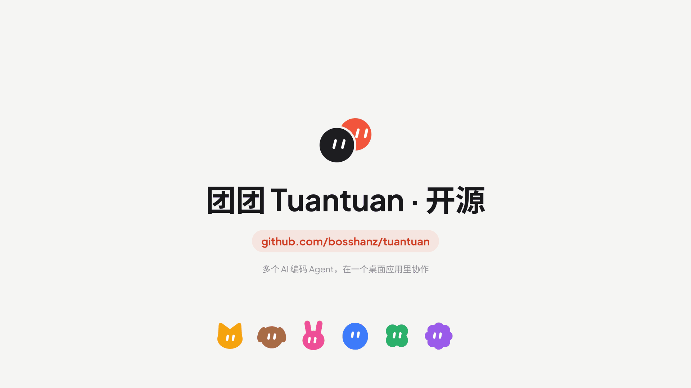
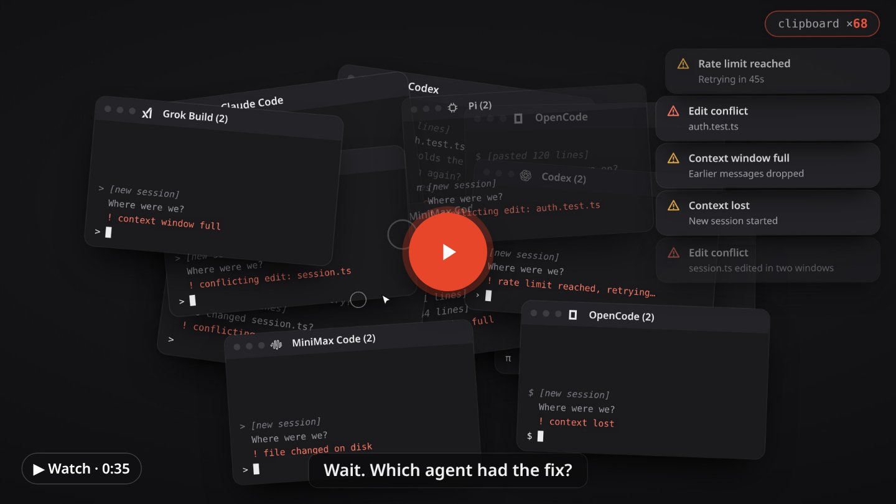
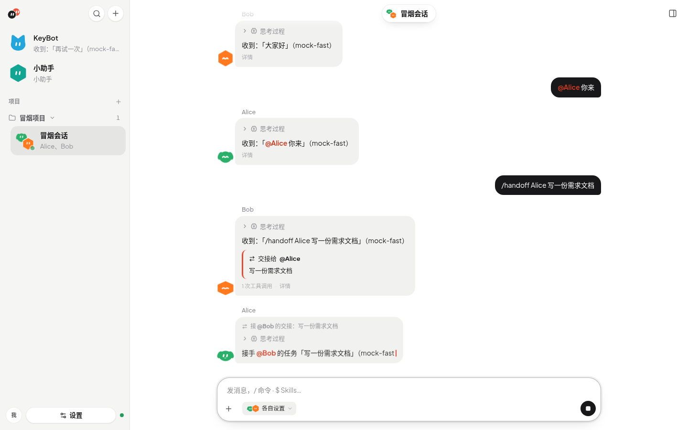

# 团团 Tuantuan

[English](README.md) | [简体中文](README.zh-CN.md) | [繁體中文](README.zh-TW.md) | [日本語](README.ja.md)



<a href="https://bosshanz.github.io/tuantuan/assets/six-windows.mp4"></a>

**一群 Agent，团团协作。** 本机多 Agent 协作工作台。

把 Claude Code、Codex、OpenCode、Pi、Grok Build、MiniMax Code，以及其他编码 Agent 放进按项目组织的会话。团团通过 [Agent Client Protocol（ACP）](https://agentclientprotocol.com)连接这些编码运行时（Harness）。

可使用 macOS、Windows、Linux 的 Electron 桌面版，或浏览器 + 本机服务。模型由你自己的 Harness 账号或 API 服务商提供，团团不自带模型服务。



*截图使用简体中文界面，也可切换为英语、繁体中文或日语。*

## 主要功能

- **选择 Harness**：沿用本机已有安装，或从 ACP Registry 安装 Agent；按 Harness 提供的登录方式完成设置。
- **多 Agent 协作**：一个会话可有一名或多名 Agent。用 `@` 指定成员，或由主 Agent 分工、跟进、汇总。所有成员共用项目工作目录。
- **结构化上下文交接**：交接携带任务说明、目标、关键决策和未完成事项；长消息和结果可分页追读。每名 Agent 保留自己的 Harness 会话，交接不复制来源 Agent 的私有会话历史。
- **保留原生编码能力**：Claude Code、OpenCode、Pi、Codex 沿用原生提示词与上下文管理。团团展示各 Harness 实际提供的模型、权限、推理和斜杠命令选项，具体能力因 Harness 而异。
- **完整呈现过程**：流式回复、Harness 提供的思考、工具调用、diff、终端输出、计划和权限请求；支持 Markdown、Mermaid 图表及单独停止任务。
- **自定义 API**：为 Claude Code、OpenCode、Pi、Codex 配置兼容服务商。直接 BYOK 模式支持 OpenAI Chat Completions、OpenAI Responses、Anthropic Messages，可对话和交接，没有文件或终端工具；兼容性取决于 Harness 与服务商协议。
- **沿用本机配置**：发现本机 Skills 和 Claude 插件，按 Agent 选择；只读导入 CC Switch 服务商，查看 Harness 实际报告的 Token 和额度。团团不改写 `~/.claude` / `~/.codex`。
- **四种界面语言**：简体中文、繁体中文、英语、日语。切换界面语言不改变聊天内容与模型回复语言。

完整清单见[功能一览](docs/features.md)。

## 下载 v0.1.1

前往 [GitHub Releases](https://github.com/bosshanz/tuantuan/releases/tag/v0.1.1) 下载桌面版：

- **macOS**：Apple 芯片（arm64）或 Intel（x64），提供 `.dmg` 和 `.zip`。
- **Windows**：x64 `.exe` 安装包。
- **Linux**：x64 `.AppImage`。

桌面版已包含运行时，无需安装 Bun。v0.1.1 的 macOS 包使用 ad-hoc 签名，未经 Apple 公证；Windows 安装包未代码签名。详见[安装与签名说明](docs/install.md)。

### macOS 首次打开（未公证）

团团暂时没有 Apple Developer ID，macOS 会拦截第一次打开，这是正常的：

1. 打开 `.dmg`，把 **tuantuan.app** 拖进「应用程序」（用 `.zip` 时在访达里双击解压，再把 `tuantuan.app` 移到「应用程序」）。不要直接在磁盘映像里运行。
2. 打开一次。macOS 提示无法验证时点「完成」（不要点「移到废纸篓」）。
3. 打开「系统设置 → 隐私与安全性」，滚动到「安全性」，在「已阻止“tuantuan”」旁点「仍要打开」，输入密码后再点「打开」。macOS 14 及更早版本也可以按住 Control 点按 App → 「打开」→「打开」。
4. 如果提示「已损坏，无法打开」或仍然打不开，在「终端」执行下面的命令后再打开：

   ```bash
   xattr -dr com.apple.quarantine /Applications/tuantuan.app
   ```

如果窗口提示服务无法启动，日志在 `~/Library/Application Support/团团/logs/server.log`。

## 快速开始（从源码构建）

需要 [Bun](https://bun.sh) **1.4.2**，与 CI 保持一致。

```bash
git clone https://github.com/bosshanz/tuantuan.git
cd tuantuan
bun install
bun run dev
```

打开 **http://localhost:5173**。首次引导会帮助你选择或安装 Harness、按需登录并创建第一名 Agent。为工作目录创建项目后，即可开始单人或多 Agent 会话。

默认界面为简体中文，可在**设置 → 个人资料 → 界面语言**切换。

无需 Harness 登录也能体验模拟回复，使用以下命令启动后选择 Mock Harness：

```bash
TUANTUAN_MOCK_HARNESS=1 bun run dev
```

由本机 API 服务托管构建后的前端：

```bash
bun run build && bun start
```

打开 **http://localhost:8787**。服务默认监听 `127.0.0.1`，面向本机单用户使用。

### 构建桌面版

完成 `bun install` 后，为当前操作系统和架构构建安装包：

```bash
bun run desktop:install
bun run desktop:build
```

产物位于 `desktop/release/`。平台差异与签名步骤见[安装与运行](docs/install.md)。

## 文档

详细文档目前使用**简体中文**。

- [安装与运行](docs/install.md) · [Harness 与 ACP Registry](docs/harness.md) · [会话与交接](docs/conversations.md) · [Skills 与插件](docs/skills.md)
- [服务商、BYOK 与用量](docs/providers.md) · [配置与 mock](docs/configuration.md) · [界面](docs/ui.md) · [开发与测试](docs/development.md)
- [常见问题与已知限制](docs/faq.md) · [产品规则](docs/product.md) · [架构](docs/architecture.md) · [ACP 计划](docs/plan-harness-acp.md)

[全部文档索引](docs/README.md)。

## 参与贡献

欢迎 Issue 和 PR！请先阅读[贡献指南（简体中文）](CONTRIBUTING.md)与[行为准则（英语）](CODE_OF_CONDUCT.md)。漏洞报告请遵循[安全策略（简体中文）](SECURITY.md)。

## 商标与第三方许可

来自 [@lobehub/icons](https://github.com/lobehub/lobe-icons) 的厂商 Logo 仅用于标识对应模型服务商。商标归各自所有者所有，本项目与这些公司没有关联，也未获其背书。第三方许可见[第三方声明（简体中文）](THIRD_PARTY_NOTICES.md)，模型目录与适配来源见[模型数据说明（英语）](server/data/NOTICE.md)。

## License

[MIT](LICENSE)
