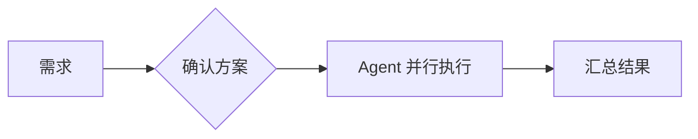
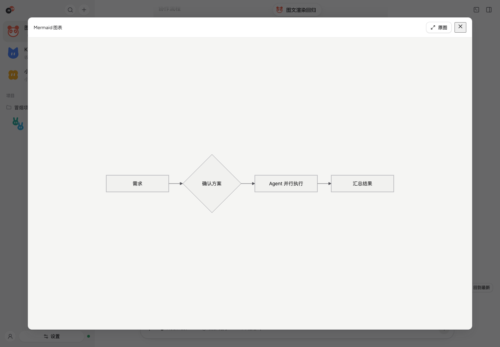

# 会话与消息

会话规则、群主统筹与交接、上下文压缩与恢复、消息阅读、会话设置和文件夹选择。

## 会话规则

| 你发的消息 | 谁回复 |
| --- | --- |
| `@产品经理 …` | 只有被 @ 的 Agent（可以 @ 多个，不同 Agent 并行回复） |
| 不 @ 任何人 | **群主（主 Agent）**负责本轮分工、跟进和最终汇总（仅 2+ Agent）；简单任务可自己完成 |
| `@所有人`（或 `@all` / `@everyone`） | 每个成员各回复一次，不同 Agent 并行 |

- 会话里所有 Agent 共用项目目录。2+ Agent 时创建会话会选主 Agent。
- **会话转述**：从截至本次请求的最近 30 条记录中选取相关消息，交接时再补入近期记录中的本轮已完成回复，按约 8000 字符裁剪。当前任务的原始请求与引用快照单独附上。排队期间到来的新消息不会替换本次任务。单 Agent 会话直接转发用户消息。
- **群主统筹**：不 @ 时，群主用 `handoff` 分工；一批成员全部完成、失败或取消后，结果自动交回群主。它可以补充分工或给出最终汇总。明确 @ 成员（包括群主）和 @所有人 保持直接对话，不自动召回群主。更换群主只影响新请求，进行中的任务由原负责人收尾。
- **交接**：多 Agent 会话注入 `tuantuan` MCP（`handoff` / `list_members` / `read_result`）。调用 `handoff` 后对方接手；界面显示交接卡片。正文 `@名字` 不会触发。
  - 只能交给会话里其他成员；去重与 `@所有人` 轮次规则同前。
  - 每条人类消息最多 5 次交接；来源正常回复结束后，接手任务进入目标 Agent 的队列。群主统筹时只有群主分工，自动回流不占预算，最后一批结束后仍可汇总；成员结果超过 6000 字符时可分页读全文。
  - 传输：HTTP `/mcp/<token>` 或 stdio 中转（`server/mcp-shim.ts`）。
- **并行与停止**：同一会话内，不同 Agent 并行，同一 Agent 按入队顺序执行。新消息不自动打断；输入框上方以轻量状态条分别显示参与者的头像、名字、当前状态和各自的排队数量，最多直接显示 3 位，其余显示人数，展开后可查看全部任务的头像、请求摘要与状态，并分别停止。展开、收起平滑过渡，连续点击可反向，减少动态效果时直接切换。单任务可直接停止，失败提示在折叠时也可见并能重试。停止只取消选中任务及依赖它的后续交接，独立请求继续；也可只取消一项排队任务。队列保存在服务内存，刷新浏览器可恢复状态，服务重启后不自动重放未完成工作。

## 上下文交接与压缩

每个「房间 × Agent」独立复用自己的 Harness 会话。团团保存的可见聊天记录用于展示与协作转述，模型本轮实际可见的历史由该 Harness 的会话管理决定。

### 跨 Agent 交接

`handoff(agent, task)` 在来源 Agent 正常结束回复后，把任务排入目标 Agent 的队列。接收方使用自己的会话，不复制来源 Agent 的完整工具历史或私有会话状态。

| 内容 | 传递与限制 |
| --- | --- |
| 原始用户请求 | `<tuantuan-task>` 单独保留本次请求全文与引用快照，不受转述的 8000 字符预算裁剪 |
| 近期群聊 | 从原始请求及之前的最近 30 条记录取候选；交接再从最新 30 条记录补入同一请求的已完成 Agent 回复。候选中从该 Agent 上次成功发言之后取内容，单条正文超过 2000 字符截断，整体约 8000 字符、优先保留较新消息 |
| 交接说明 | `<tuantuan-handoff>` 携带来源与 `task`；说明去除首尾空白后只保留前 4000 字符 |
| 本轮职责 | `<tuantuan-coordination>` 说明直达、负责人或成员角色；成员结果自动回流到本轮负责人 |
| 成员结果 | 群主跟进时直接从本轮任务及已保存消息收集，带任务、状态、错误、消息 ID 和回复前 6000 字符；截断结果可通过 `read_result(messageId, offset)` 分页读取，每页最多 6000 字符，仅限本轮已结束的 Agent 回复 |

这些是字符预算，原始任务、职责及成员结果另行附加，不能把 8000 当成整次模型请求上限。转述采用截断与省略，没有生成语义摘要；早期决定不会自动转成长期共享记忆。交接说明需要写清目标、必要上下文、边界和完成标准，较长资料可指向共享项目中的文件。每条人类消息最多 5 次交接，群主自动收集结果不消耗这个预算。

### 原生压缩与直接 API 的区别

| Agent 使用方式 | 谁管理上下文 |
| --- | --- |
| Claude Code / OpenCode / Pi / Codex，包括通过它们使用 DeepSeek 等自定义 API | 原生引擎管理历史、摘要与压缩策略；团团不另设统一压缩算法或阈值。模型能力目录提供的窗口等元数据可能成为引擎的输入 |
| Harness 直接选择「自定义 API（BYOK）」 | 团团持久化最多 20 个完整成功轮次；每次完整请求最多 65,536 序列化字符，超限先淘汰最旧的完整轮次，没有模型生成摘要 |

直接 API 的预算包括系统提示、工具定义、当前任务、工具链和 JSON 包装。当前轮自身超限会在发送前报错，不截断系统提示或当前任务，也不拆散工具调用与结果。失败、取消或会话重置后的迟到回复不会覆盖上一成功上下文，详见[服务商与 BYOK](providers.md#自定义-apibyok)。

界面的上下文占用来自 Harness 报告。团团尚无统一的压缩控制或摘要回看面板，也未接入专用 ACP `session.compaction` 展示；适配器若把压缩过程转成普通工具更新，仍可按工具卡片显示。原生命令是否可用取决于当前 Harness。

### 重启与恢复

团团保存每个房间 / Agent 的原生 session ID。重新连接时按 Harness 能力优先 `session/resume`，或使用 `session/load`；用户主动选择历史会话时优先 load，以取得可显示的回放。恢复失败、超过 45 秒、Harness 不支持恢复或映射已重置时会新建会话，团团不会把完整聊天记录自动灌入新会话。界面中仍能回看的记录不保证全部存在于模型上下文。

直接 API 的成功上下文保存在 SQLite，普通重启会继续使用；新会话、成员移除及项目目录 / 归属重置会持久化清空。待执行任务与交接队列只在服务内存中，服务重启不重放它们。

## 消息阅读与图表

| 内容 | 显示方式 |
| --- | --- |
| Markdown | 标题、列表、引用、链接和 GFM 表格；普通代码块保留语法高亮 |
| Mermaid | 标记为 `mermaid` 的代码围栏渲染成图表，跟随明暗主题，可展开源码 |
| 图片 | Markdown 图片、ACP 时间线图片与工具返回的图片可点击放大 |

让 Agent 返回下面这样的代码围栏，即可显示流程图；时序图等 Mermaid 语法使用同一入口：

````markdown

````

图表和图片共用放大预览：点击打开，切换「原图」查看实际尺寸或「适应窗口」查看全图。原图超出窗口时可滚动；按 Esc、点击背景或关闭按钮退出，键盘焦点回到原图片，保留消息阅读位置。预览打开时收到后续文本或切换明暗主题，不会关闭预览或重置原图模式。图片自带链接时，旁边的「打开链接」保留原链接入口。

未完成或语法有误的图表会保留源码，后续内容修正后自动恢复，也可重试。图内 HTML（无属性的 `<br>` 换行除外）、外部图片 / 图标和修改渲染设置的指令不支持，相关图表保留源码；图中的链接和回调不执行。图表输出为静态 SVG，沿用团团的字体与中性色，不播放 Mermaid 自带动画。图片显示和放大是客户端能力，能否向 Agent 发送图片仍取决于所选 Harness。



## 能力

- 流式回复、思考过程、工具卡片（文件 diff、终端输出）、计划清单、用量。生成时主动向上滚动会暂停跟随，保留历史阅读位置；回到底部或点击「回到最新」恢复跟随。
- 消息气泡外的操作栏提供引用和更多操作：桌面悬停或键盘聚焦时出现，触屏和窄窗口保留可见入口。更多菜单可复制正文、复制团团消息 ID，Agent 消息还可查看详情；复制失败可重试。群聊中可引用已完成的用户或 Agent 消息，输入框显示作者与摘录，发送失败保留引用。
- 权限请求弹窗：允许一次 / 总是允许 / 拒绝。提交期间禁止重复操作，服务端确认成功后关闭；提交失败保留弹窗并提示重试，404（请求已失效）也会关闭。
- 经过团团 ACP `fs/*` 的文件路径按真实路径校验，拒绝工作目录外的目标与符号链接逃逸；新文件校验最近的现存父目录。例外是当前 Agent 明确选中的 Skill 目录及其附属文件，允许只读，取消勾选后下一轮撤销；不扩大写入范围。ACP 终端只校验初始 `cwd`，命令仍以当前用户权限运行，可访问其他路径；Harness 自带工具也由其自身权限 / 沙箱控制。这里没有操作系统沙箱。
- 慢历史快照不会覆盖期间收到的运行状态、会话与权限事件；切换会话后旧响应不进入新会话。
- 会话开始前可在输入框旁选**模型**（Harness 通过 ACP 声明的 model 选项；BYOK 可改会话级模型 ID）。多人会话按 Agent 分别记住。中途切换走 `set_config_option`。没有模型选项时不显示。
- Harness 提供的其他配置项（模式、推理强度等）和斜杠命令（输入 `/` 弹出）。
- 粘贴或拖入图片（Harness 支持时）、随时停止、会话列表（切换 / 恢复历史会话 / 新会话）。
- 切换到 Harness 里的历史会话时用 `session/load`，Harness 回放的历史中团团没显示过的轮次（按用户消息去重）以只读方式显示在消息列表顶部。

## 会话设置（模型 / 权限 / 推理…）

Harness 通过 ACP `configOptions`（及旧的 `modes`）提供设置。输入框底栏优先显示**模型、权限、推理**这些常用入口，带图标、简短中文名和当前值，比如 `权限 询问`、`推理 高`；思考、协作、快速模式等其余选项统一放在「更多设置」。点开后列出选项名和 Harness 自己的说明。已知的 id/category（mode、model、effort/thought_level、thinking、collaboration_mode、fast-mode 等）会翻译成中文，其余沿用 Harness 给的名称。危险选项（Bypass permissions、full-access 等）用浅橙色标出。窗口较窄时，次要入口继续收进「更多设置」。多 Agent 会话只显示一个「各自设置」标签，点开后按 Agent 分组。

弹层渲染在 `<body>` 下，跟随触发按钮定位：默认向上展开，空间不够时向下，不超出窗口。

**Agent 默认设置**：在 Agent 页选好 Harness 后，团团会在临时目录开一个一次性 ACP 会话来读取可用选项（按 Harness 缓存 30 分钟）。读不到时（例如未登录）会显示原因和「重试」按钮。新会话按「会话里改过的 > Agent 默认 > Harness 默认」依次生效。

**卡住与停止**：`session/resume` / `load` 超过 45 秒会改开新会话；切换设置超过 20 秒算失败，Harness 拒绝时会直接显示它返回的原因。初始化会话期间点「停止」会立即停止等待，不再发送该任务的 prompt；已发出 prompt 时先发 `session/cancel`，默认 4 秒内仍未结束则强制终止该会话中该 Agent 的 Harness 及其 ACP 终端进程组，保留已生成内容。进程按会话与 Agent 隔离，强制取消不影响其他会话；同一 Agent 的下一项独立任务等待取消完成后执行，必要时重建 / 恢复会话。回复期间切换 ACP 历史会话会提示先停止当前任务。Agent 设置、项目目录或会话选择变更后，旧的初始化结果不会重新挂回。回复 15 秒还没有任何输出时，会显示等了多久。

## 选择文件夹

浏览器拿不到绝对路径，所以由服务端弹系统对话框：macOS 用 `osascript choose folder`，Linux 桌面用 `zenity` / `kdialog`。都不可用时（或 `TUANTUAN_NATIVE_PICKER=0`）改用应用内的文件夹浏览器（面包屑、常用目录、最近项目、git 仓库标记）。接口统一为 `POST /api/fs/pick`、`GET /api/fs/dirs`、`GET /api/fs/places`；桌面壳可通过 `setNativePicker()` 换成自己的原生对话框。新建项目、项目设置、Skill 导入都用它。


---

[← 返回 README](../README.md) · [文档索引](README.md)
