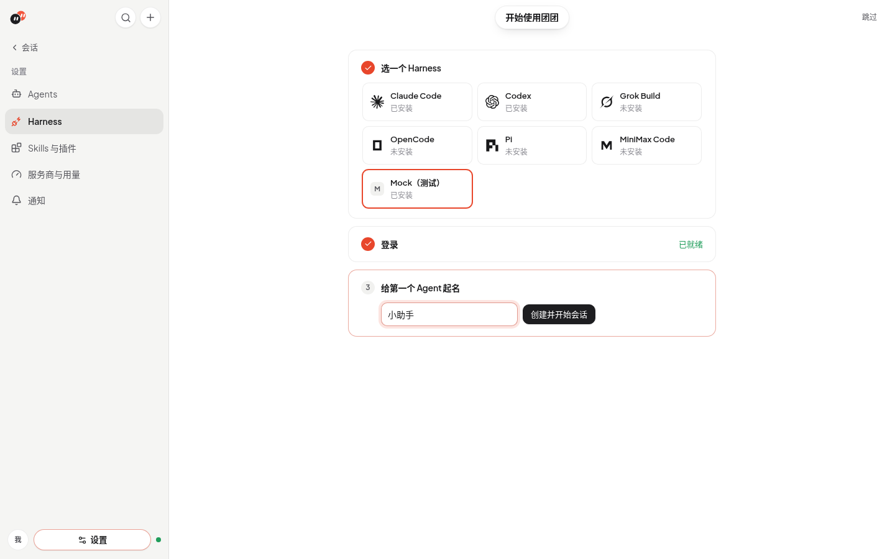
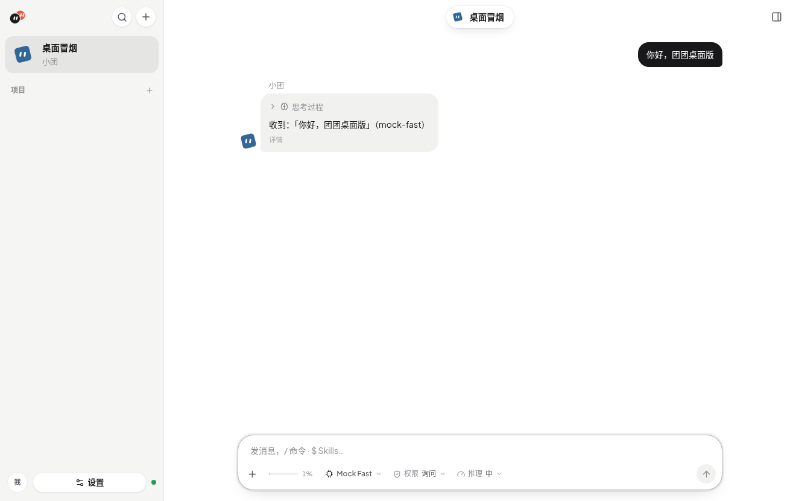
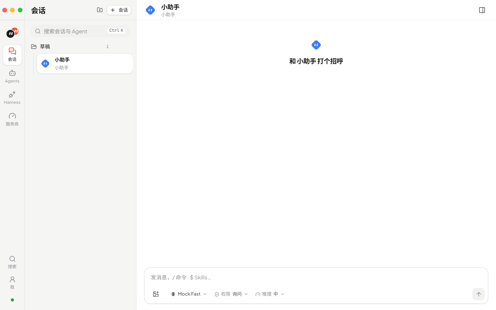

# 安装与运行

下载桌面安装包，或从源码运行（浏览器 + 本机服务）和构建桌面版。

## 下载桌面版 v0.3.1

前往 [GitHub Releases v0.3.1](https://github.com/bosshanz/tuantuan/releases/tag/v0.3.1)，按操作系统和芯片选择安装包：

| 平台 | 安装包 |
| --- | --- |
| macOS · Apple 芯片（arm64） | `Tuantuan-0.3.1-mac-arm64.dmg` |
| macOS · Intel（x64） | `Tuantuan-0.3.1-mac-x64.dmg` |
| Windows · x64 | `Tuantuan-0.3.1-win-x64.exe` |
| Linux · x64 | `Tuantuan-0.3.1-linux-x64.AppImage` |

macOS 也提供对应架构的 `.zip` 包。桌面版已包含运行时，无需安装 Bun。v0.3.1 的 macOS 包使用 ad-hoc 签名，未经 Apple 公证；Windows 安装包未代码签名，因此系统可能显示开发者或发布者验证提示。v0.2.1 起提供「关于与更新」入口。macOS 当前推荐通过 Homebrew 升级，暂不配置 Apple Developer；从 v0.2.0 首次升级也需 Homebrew 或手动安装。

- **macOS（Homebrew，推荐）**：`brew install --cask bosshanz/tap/tuantuan`。[这个 tap](https://github.com/bosshanz/homebrew-tap) 安装后会自动清除隔离标记，打开时不会被 Gatekeeper 拦截，升级用 `brew upgrade --cask tuantuan`。
- **macOS**：打开 `.dmg`，把 **tuantuan.app** 拖进「应用程序」后启动（用 `.zip` 时在访达里双击解压，再移到「应用程序」）。不要直接在磁盘映像里运行。因为没有 Developer ID 和公证，第一次打开会被拦截：
  1. 提示无法验证时点「完成」（不要点「移到废纸篓」）。
  2. 打开「系统设置 → 隐私与安全性」，滚动到「安全性」，在「已阻止“tuantuan”」旁点「仍要打开」，输入密码后点「打开」（参见 [Apple 的说明](https://support.apple.com/en-us/102445)）。macOS 14 及更早版本也可以按住 Control 点按 App →「打开」。macOS 15 起这个右键方式不再绕过拦截，只能用「仍要打开」。
  3. 提示「已损坏，无法打开」或仍然打不开时，在「终端」执行 `xattr -dr com.apple.quarantine /Applications/tuantuan.app` 后再打开。
  4. 窗口提示服务无法启动时，日志在 `~/Library/Application Support/团团/logs/server.log`；数据在同一目录。图形界面启动的 App 拿不到终端的 PATH，团团会从登录 shell 读取并补上 Homebrew、`~/.local/bin`、`~/.bun/bin` 等常见目录；仍找不到 Harness 时，在「Harness」页填绝对路径。
  5. 桌面版默认不内置 Claude Code / Codex 适配器，第一次使用时在「Harness」页从 ACP Registry 一键安装。官方 DeepSeek Harness 预发布版也在此按需安装，团团为它提供所需的 Node；它是团团补充的官方 npm 条目，详见 [Harness](harness.md#deepseek-官方-harness预发布)。
- **Windows**：运行 `.exe`，按安装向导完成安装。
- **Linux**：给 `.AppImage` 添加可执行权限后运行：

  ```bash
  chmod +x Tuantuan-0.3.1-linux-x64.AppImage
  ./Tuantuan-0.3.1-linux-x64.AppImage
  ```

## 从源码运行

使用 [Bun](https://bun.sh) 1.4.2 安装依赖，与 CI 保持一致。仓库使用 v2 锁文件，Bun 1.3.14 无法读取；已有依赖环境下的历史检查结果不能代替首次安装验证。Skill 解析依赖内置的 `Bun.YAML`，验证记录见 [ACP 计划](plan-harness-acp.md)。

```bash
git clone https://github.com/bosshanz/tuantuan.git
cd tuantuan
bun install
bun dev          # 同时启动 API（:8787）和前端（:5173）
```

开发模式下 Vite 会把 `/api`、`/mcp` 和 `/ws` 转发到 API（列表在 `server/routes.ts`）。改了 `vite.config.ts` 或这个列表后要重启 `bun dev`。

打开 http://localhost:5173 ：

1. 首次启动是一页三步的引导（随时可「跳过」，只出现一次）：选一个 Harness（没装就一键安装）→ 需要时登录（Harness 自带登录按钮，或复制终端命令，回到窗口自动重新检测）→ 给第一个 Agent 起名，创建后直接在「草稿」里打开会话。之后在左侧「Harness」（`#/harness`）管理全部 Harness。

   

2. 「Agents → + 新建」创建 Agent：选 Harness、权限策略、身份文档、MCP 服务器和环境变量。
3. 「会话」侧栏按**项目**分组。先建项目（新建目录，或选择已有文件夹；根目录默认 `~/Tuantuan`，可用 `TUANTUAN_WORKSPACES` 改），再在项目下建会话。未选项目时进默认项目「草稿」（`~/Tuantuan/drafts`）。会话共用项目目录；2+ Agent 时可设**主 Agent**。更换项目目录会重置该项目下会话的 Harness 上下文。

生产方式：`bun run build && bun start`（API 同时托管 `web/dist`，访问 http://localhost:8787）。API 默认只监听 `127.0.0.1`；HTTP（含 MCP）与 WebSocket 升级均校验本机 Host、浏览器 Origin 和跨站请求标记，正常的本机 Vite 代理可用。原生本机客户端可省略 Origin。`TUANTUAN_HOST` 可改监听地址，但不会关闭请求检查，也不提供远程访问鉴权。

## 桌面版（Electron）

可直接使用 [v0.3.1 安装包](https://github.com/bosshanz/tuantuan/releases/tag/v0.3.1)，也可按下方步骤自行构建。数据在系统的应用数据目录（macOS `~/Library/Application Support/团团`，菜单「帮助 → 打开数据文件夹」），会话文件夹默认在 `~/Tuantuan`。Claude Code 和 Codex 默认不打进安装包，第一次用时在「Harness」页一键从 ACP Registry 下载；打包时设 `TUANTUAN_BUNDLE_ADAPTERS=1` 可改回内置。DeepSeek 官方预发布版始终按需安装，不捆绑进桌面包。你自己装的 Harness 和 CC Switch 设置的环境变量会从登录 shell 读到。



桌面版可在「设置 → 通知 → 任务运行」开启「Agent 任务运行中阻止自动休眠」（默认关闭）。开启后，只要任一会话仍有 Agent 任务，团团会阻止系统自动休眠，屏幕仍可熄灭；所有任务结束、失败、取消或关闭开关后释放，退出团团时也会释放。切换会话、刷新页面或隐藏窗口不会中断检测。浏览器版不支持控制系统休眠。

界面是单侧栏布局：侧栏顶部是搜索和「+」，下面是会话（大头像 + 最后一条消息），再下面是「项目」分组（可折叠，当前项目自动展开）；底部是你的头像和「设置」（Agents、Harness、服务商与用量都在这里）。主区顶部是居中的悬浮标题，点击打开右侧详情（详情 / 资料库 / 成员）。macOS 上窗口没有系统标题栏，红绿灯在侧栏顶行左侧，搜索和「+」在它右边；全屏时这块空位收回。



自己打包：

```bash
bun install && bun run desktop:install   # 第一次：装 Electron 和打包工具
bun run desktop:dev                      # 开发：构建前端后用 Electron 打开
bun run desktop:build                    # 当前系统、当前架构的安装包 → desktop/release/
bun run desktop:build -- --arch arm64,x64   # macOS 同时出 Apple 芯片和 Intel 包
xvfb-run -a bun run desktop:smoke        # Linux：无界面端到端冒烟
```

macOS 本机构建：在 Mac 上执行上面的依赖安装和 `desktop:build` 命令，会生成当前架构的 `.dmg` 和 `.zip`；使用 `--arch arm64,x64` 可同时生成 Apple 芯片和 Intel 版本。未配置 Developer ID 证书时，构建配置使用 ad-hoc 签名；它不等同于 Developer ID 签名或 Apple 公证。要使用 Developer ID 签名并公证，打包前设置 `CSC_LINK`、`CSC_KEY_PASSWORD`（Developer ID 证书）和 `APPLE_ID`、`APPLE_APP_SPECIFIC_PASSWORD`、`APPLE_TEAM_ID`；Windows 签名使用 `WIN_CSC_LINK`、`WIN_CSC_KEY_PASSWORD`。

### 配置 macOS 正式签名与公证（可选，当前暂缓）

当前发布使用 Homebrew，不需要 Apple Developer 会员或以下 Secrets。下面保留以后启用 macOS 应用内安装时的配置步骤，对应仓库的 electron-builder 26 和 `.github/workflows/desktop.yml`。正式签名与公证配置完成后，再用同一发布身份签名的两个连续版本验证 macOS 应用内升级。

1. 使用有效的 Apple Developer Program 账号，在 [Certificates, Identifiers & Profiles](https://developer.apple.com/help/account/certificates/create-developer-id-certificates/) 创建 **Developer ID Application** 证书。按页面要求在 Mac 钥匙串生成 CSR，上传后下载并安装证书；在「钥匙串访问 → 我的证书」中确认它带有私钥，将证书和私钥导出为带密码的 `.p12`。这里不使用 Developer ID Installer 或 Apple Development 证书。
2. 在 [Apple Account](https://account.apple.com/) 的「登录与安全 → App 专用密码」生成供公证使用的密码；账号需要开启双重认证。Apple Developer 会员信息页可查到 10 位 Team ID。具体入口见 [Apple 说明](https://support.apple.com/en-us/102654)。
3. 打开 **tuantuan 主仓库**的 [Settings → Secrets and variables → Actions](https://github.com/bosshanz/tuantuan/settings/secrets/actions)，新增以下 **Repository secrets**：

   | Secret 名称 | 内容 |
   | --- | --- |
   | `MAC_CSC_LINK` | `.p12` 文件的 Base64 内容，包含私钥；不是本机文件路径 |
   | `MAC_CSC_KEY_PASSWORD` | 导出 `.p12` 时设置的密码 |
   | `APPLE_ID` | Apple Developer 账号邮箱 |
   | `APPLE_APP_SPECIFIC_PASSWORD` | 上一步生成的 App 专用密码，不是 Apple 账号登录密码 |
   | `APPLE_TEAM_ID` | 证书所属团队的 10 位 Team ID |

工作流会把前两项映射为 electron-builder 的 `CSC_LINK` / `CSC_KEY_PASSWORD`，仅注入 macOS 构建。Windows 可另外配置 `WIN_CSC_LINK` / `WIN_CSC_KEY_PASSWORD`；未配置时继续构建未签名的 Windows 包，不会回退使用 Mac 证书。

已登录 GitHub CLI 时，也可以直接通过标准输入上传证书，避免把 Base64 打印到终端或写进仓库；其他值在 `gh secret set` 的交互提示中输入：

```bash
base64 -i "/absolute/path/DeveloperID.p12" | gh secret set MAC_CSC_LINK --repo bosshanz/tuantuan
gh secret set MAC_CSC_KEY_PASSWORD --repo bosshanz/tuantuan
gh secret set APPLE_ID --repo bosshanz/tuantuan
gh secret set APPLE_APP_SPECIFIC_PASSWORD --repo bosshanz/tuantuan
gh secret set APPLE_TEAM_ID --repo bosshanz/tuantuan
```

配置后先手动运行 Desktop 工作流做构建，保持 `publish` 不勾选。下载并解压两种 macOS 架构的产物，分别检查 Developer ID / TeamIdentifier、签名和公证票据；以实际解压出的 `.app` 路径替换下例：

```bash
codesign -dv --verbose=4 "/path/to/团团.app"
codesign --verify --deep --strict --verbose=2 "/path/to/团团.app"
spctl --assess --type execute --verbose=4 "/path/to/团团.app"
xcrun stapler validate "/path/to/团团.app"
```

应看到有效 Developer ID 签名、正确 TeamIdentifier、Gatekeeper 接受和公证票据验证成功。仅设置 Secrets 或构建任务成功不能代替这些产物检查。首个正式签名版本要先手动安装作为 OTA 基线；下一个版本沿用同一发布身份和 `appId`，在不由 Homebrew 管理的安装上验证应用内升级。参考 [electron-builder 26 签名](https://www.electron.build/v26/docs/features/code-signing/)与[公证说明](https://www.electron.build/v26/docs/notarization/)。

### 关于与更新（v0.2.1 起）

「设置 → 关于与更新」显示当前版本、可用版本与发布说明，可以手动检查更新或控制后台检查。后台检查不会自动下载安装；下载完成后由用户选择重启安装或稍后处理。任何会话仍在运行、排队、等待权限或提问、取消收尾时都不能安装，无法确认任务状态时也不会退出。任务结束后不会自行安装，仍需再次点击。

重启前先保存各会话的草稿、图片、引用、阅读位置与当前页面，再由服务端原子确认空闲并阻止新任务进入。保存或安装准备失败时保留当前应用并恢复操作；恢复文件只有在新版成功导入后才清除，恢复失败可重试。浏览器版不提供桌面安装操作。 正常退出应用也执行同样的工作区保存，以便 Homebrew 升级后跨端口恢复；保存失败会提示并保留当前应用供重试。macOS 红点关闭仅隐藏窗口，正常退出请使用菜单或 Cmd+Q；强制退出和断电无法保证最后一次保存。

源码构建的正式安装包默认写入 GitHub Releases 更新源，不需要上传凭据。`TUANTUAN_UPDATE_FEED=none` 可在打包时显式关闭；开发运行不使用正式更新源。`desktop:build` 始终只构建，不上传，`TUANTUAN_PUBLISH` 不再控制包内更新源。

Windows NSIS 和 Linux AppImage 可在应用中检查、下载并安装更新；macOS 必须具备正式签名才使用自动安装，当前 ad-hoc 包会引导前往 Release 下载。Homebrew 安装先等待 Agent 任务完成并正常退出团团，再执行 `brew update && brew upgrade --cask tuantuan`，完成后重新打开，避免应用内安装脱离 brew 的版本记录。Homebrew 是外部包管理器，不受团团的安装锁控制，不能在 Agent 仍运行时直接替换应用。已经发布的 v0.2.0 不会因这次源码改动自动获得更新功能。

更新界面与重启恢复的开发回归可运行 `bun run build && bun run e2e:updates`（需要本机 Chrome，`CHROME_PATH` 可覆盖）。它使用真实浏览器、IndexedDB、本地服务与 mock ACP，更新器桥接使用模拟；不会下载或安装正式新版本。

### Linux 更新失败后的恢复

AppImage 更新在旧实例退出后启动暂存的新版，保留旧可执行文件直到新版服务和窗口就绪。启动就绪确认还会核对本次更新标识和镜像路径；仅创建子进程不算成功。新版首次启动失败时不会自动回滚，旧包和数据目录中的 `appimage-update.json` 会保留。

恢复记录的 `previous` 指向旧可执行文件：普通带版本号的文件保持原路径；自定义同名安装会保存为 `.UUID.previous` 备份。退出失败的新实例后，可从该路径启动旧版；同名备份也可通过文件管理器恢复为记录里的 `current` 路径。确认旧版可用后，再移走失败的新镜像并清理该恢复记录，才能重新尝试应用内更新。聊天数据库与更新前的草稿恢复文件保持不变。

## 发布安装包和更新清单

GitHub Actions 的 Desktop 工作流分为构建、完整性校验、发布、Homebrew 同步四步。三个系统全部构建成功后，才汇总以下正式文件：

- macOS arm64 / x64 各一份 `.dmg`、`.zip` 和它们各自的 `.blockmap`。
- Windows x64 `.exe` 和 `.exe.blockmap`。
- Linux `Tuantuan-<version>-linux-x64.AppImage`（blockmap 内嵌于文件）。
- `latest-mac.yml`、`latest.yml`、`latest-linux.yml` 和覆盖上述文件的 `SHA256SUMS.txt`。

macOS 的 Bun 运行时需要逐架构准备，因此打包脚本仍分别调用 builder，但会保留 `latest-mac-arm64.yml` / `latest-mac-x64.yml` 中间清单并合并成包含两个架构的 `latest-mac.yml`；中间清单不发布。Linux 文件名固定使用既有下载链接中的 `x64`，更新清单引用同一个实际文件。

每个安装包的实际 SHA-512、大小、清单版本与引用、两个 macOS 架构、外置与内嵌 blockmap 都通过校验后，才生成独立的 `release-ready` 工作流产物。blockmap 校验覆盖锁定 builder 的单个 `file`、零偏移、分块长度总和及 18 字节 base64 校验码格式，不重新计算每块校验码；安装包的完整内容另以整包摘要校验。标签必须与 `desktop/package.json` 的稳定版本完全一致（例如 `v0.2.5` 对应 `0.2.5`）。缺包、混入不同版本、摘要错误或元数据引用缺失都会阻止发布。

默认工作流只上传构建与校验后的产物。真正发布有两个入口：仓库变量 `TUANTUAN_PUBLISH=github` 启用 `v*` 标签推送后的发布；或手动运行工作流，选择对应 **标签** 并勾选 `publish`。手动选择分支不能发布。发布任务使用仓库自带的 `GITHUB_TOKEN`（仅该任务授予 `contents:write`），先上传到草稿 Release，通过 `gh release view` 取得 ID，再按 ID 核对 GitHub 返回的每个文件名、大小和 SHA-256，全部匹配后才公开。已有同名 Release（包括草稿）会拒绝覆盖；上传或校验失败时检查保留的草稿后再决定恢复方式。不同标签的工作流使用同一个仓库级并发组，串行完成发布与 Homebrew 同步；公开前还会重新读取当前 latest 并比较稳定版本，较旧构建即使较晚完成也不能把更新入口倒退。

本地也可使用同一脚本，先把三个系统的构建产物放进同一个目录；`prepare` 不联网：

```bash
# 示例：先将 desktop/package.json 改为计划发布的稳定版本，并准备对应标签。
bun desktop/scripts/release.ts prepare --tag v0.2.5 --dir desktop/release --output desktop/release-ready
# 仅在决定发布时执行；需要已安装 gh、已推送的版本标签与 GH_TOKEN 的仓库 contents:write 权限。
bun desktop/scripts/release.ts publish --tag v0.2.5 --dir desktop/release-ready --repo bosshanz/tuantuan
```

`prepare` 的输出目录必须不存在，防止混入旧版本。需要重试时用新的输出目录，或确认后删除旧目录。正式 macOS 签名和公证仍使用前述证书配置；包内更新源和发布脚本不会绕过系统签名检查。

## 发布版本时同步 Homebrew

公开 Release 后，工作流用 `desktop/scripts/sync-homebrew.ts` 同步 [bosshanz/homebrew-tap](https://github.com/bosshanz/homebrew-tap) 的 `Casks/tuantuan.rb`。脚本只接受已公开的稳定版本，下载 Release 的 `SHA256SUMS.txt` 和 arm64 / x64 两份 `.dmg`，核对文件名、下载 URL、实际 SHA-256 与清单，再更新 cask 的版本和双架构哈希；其余内容保持原样。版本回退、同版本不同摘要、缺架构或任一校验失败都不会写入 cask。

本次发布先使用下方手动同步流程；`HOMEBREW_TAP_TOKEN` 未配置不妨碍本地校验、提交和推送 tap。启用 Actions 自动提交和推送时，需要配置明确命名的仓库 Secret **`HOMEBREW_TAP_TOKEN`**：使用只能访问 `bosshanz/homebrew-tap` 且具备 **Contents: read and write** 的 fine-grained PAT，或等价的 GitHub App token。它与主仓库的 `GITHUB_TOKEN` 分开，Git 身份只在 tap 工作副本配置。受保护分支还须允许该凭据按仓库规则写入。

配置 fine-grained PAT：

1. 打开 GitHub 个人 **Settings → Developer settings → Personal access tokens → Fine-grained tokens → Generate new token**（[创建入口](https://github.com/settings/personal-access-tokens/new)），设置名称和有效期。
2. **Resource owner** 选 `bosshanz`，**Repository access** 选 `Only select repositories`，只勾选 `homebrew-tap`。
3. **Repository permissions → Contents** 选 `Read and write`；Metadata 只读随之保留，无需 Actions、Administration 或 Workflows 写权限。若 tap 的分支规则要求 PR，不要为同步擅自放宽规则，应改用符合规则的凭据或发布流程。
4. 生成后将 token 存入 **bosshanz/tuantuan 主仓库**的 Actions Repository secret，名称必须为 `HOMEBREW_TAP_TOKEN`。也可执行 `gh secret set HOMEBREW_TAP_TOKEN --repo bosshanz/tuantuan`，在提示中粘贴。Token 的访问目标是 tap，存放位置是执行发布工作流的主仓库。

参考 [GitHub PAT 配置说明](https://docs.github.com/en/authentication/keeping-your-account-and-data-secure/managing-your-personal-access-tokens)与[Actions Secrets](https://docs.github.com/en/actions/how-tos/write-workflows/choose-what-workflows-do/use-secrets)。密钥过期或撤销后需替换相同 Secret；这些值不用提供给聊天，也不写入配置文件或 PR。

缺少 token 时，Release 保持已发布，Homebrew 任务以 `::notice` 跳过并给出手动恢复命令，不再把整个 job 标红。配置好 token 后会自动同步；也可手动运行同一脚本：

```bash
git clone https://github.com/bosshanz/homebrew-tap.git /path/to/homebrew-tap
bun desktop/scripts/sync-homebrew.ts --tag v0.2.5 --tap /path/to/homebrew-tap
git -C /path/to/homebrew-tap diff -- Casks/tuantuan.rb
git -C /path/to/homebrew-tap add Casks/tuantuan.rb
git -C /path/to/homebrew-tap commit -m 'Update tuantuan to v0.2.5'
git -C /path/to/homebrew-tap push
```

脚本自身不提交或推送，不写全局 Git 设置或密钥。重复同步相同版本与摘要不会产生新改动。完成后确认 `brew info --cask bosshanz/tap/tuantuan` 显示新版本，按对应架构验证下载与安装。离线回归可用 `--release-json /path/to/release.json --assets /path/to/assets`；完整 fixture 测试执行 `bun test tests/desktop-release.test.ts`。

---

[← 返回 README](../README.md) · [文档索引](README.md)
