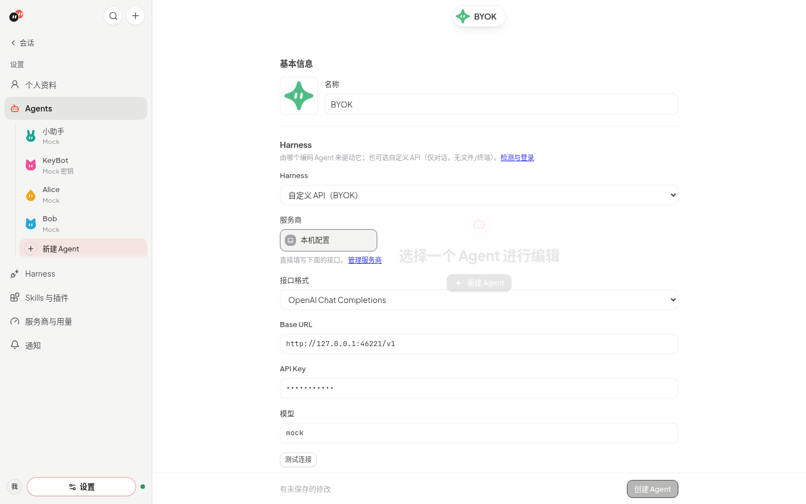
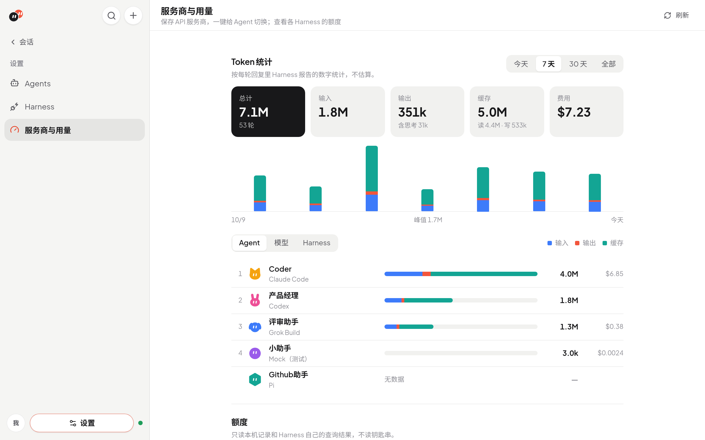
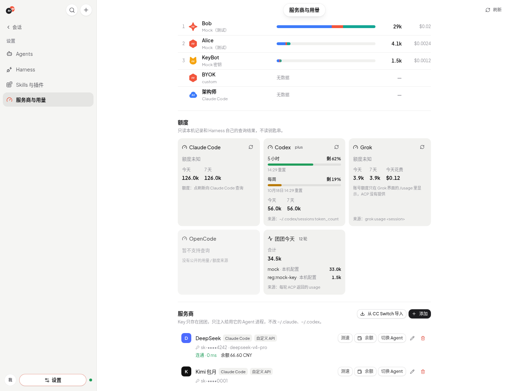
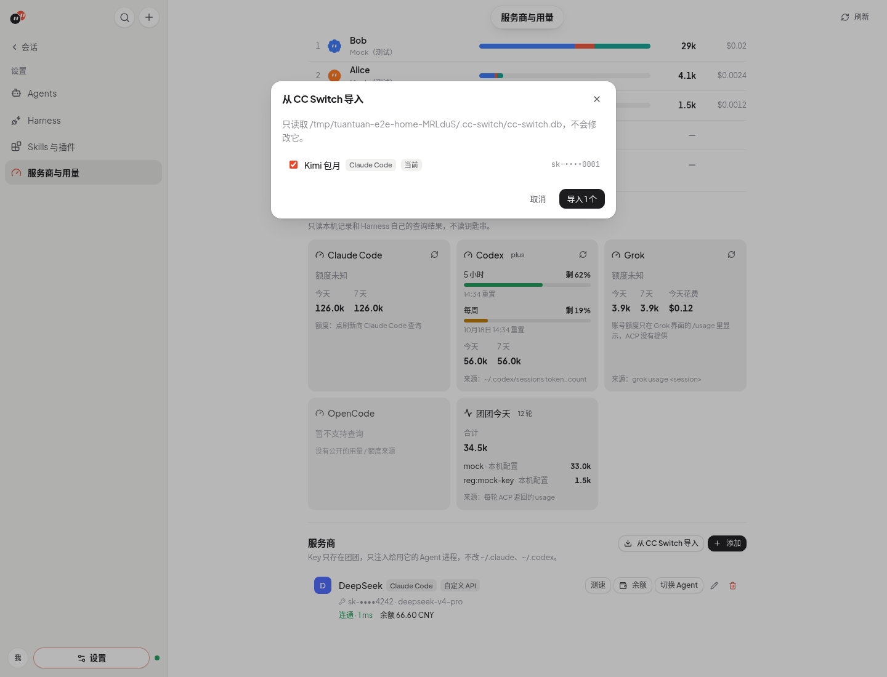
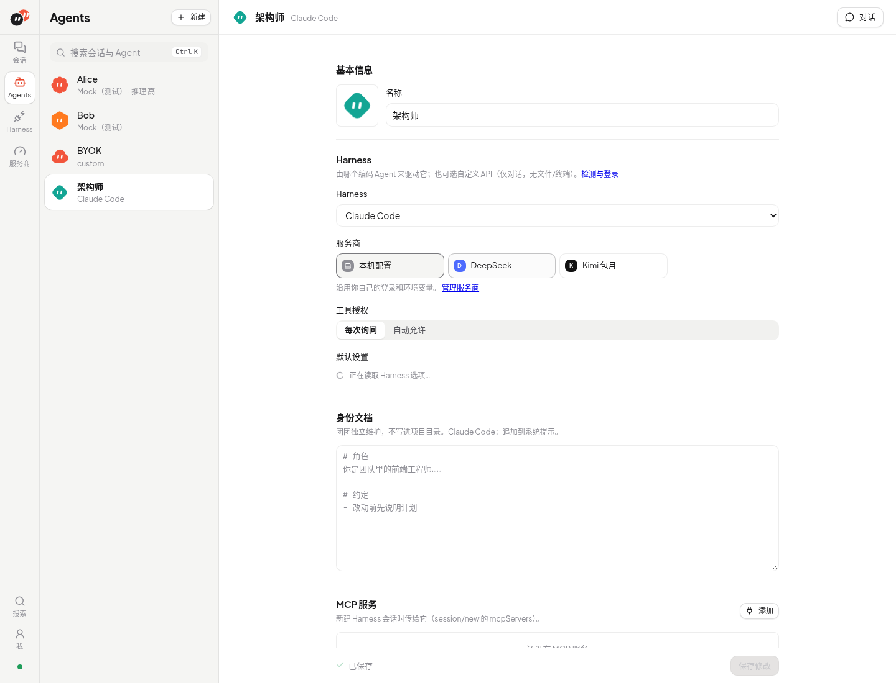

# 服务商、BYOK 与用量

自定义 API（BYOK）、可复用的服务商、CC Switch 导入、Token 统计与额度。

## 自定义 API（BYOK）

新建 Agent 时 Harness 选「自定义 API（BYOK）」：接口格式（OpenAI Chat Completions / OpenAI Responses / Anthropic Messages）、Base URL、API Key、模型，可点「测试连接」。

- 团团内置的轻量 harness，只做对话：SSE 流式、身份文档作系统提示、会话转述；多 Agent 时 `handoff` / `list_members` 以原生 function/tool call 提供（与 MCP 走同一处理逻辑）。**没有文件读写和终端。**
- 对话上下文按完整成功轮保存，最多 20 轮；每次请求的序列化字符上限为 65,536，超限先移除完整旧轮，当前任务自身超限会提示错误。重启后继续同一上下文；新会话、成员移除或更换项目目录 / 归属会清空，失败或取消不会写入半轮。聊天记录仍可回看；字符预算不等于模型 token 窗口。
- API Key 以明文保存在服务端 SQLite，专用接口只返回掩码（如 `sk-••••abcd`），不写日志；编辑时留空即保持原 Key。服务商 Key、管理 Key 与 Harness `env_var` 登录 Key 也保存在同一数据库；打码不代表磁盘加密。Harness 原生登录态仍由 Harness 管理。普通 Agent 环境变量属于可读写配置，不能视为专用密钥存储。系统钥匙串集成仍未实现。

## 服务商与用量

左侧「服务商」页保存可复用的 API 服务商（名称、图标、Anthropic 兼容地址、OpenAI 兼容地址、Key、主模型 / 快速模型、接口格式）。预设：Anthropic、OpenAI、xAI Grok、DeepSeek、Kimi、智谱 GLM、通义千问、MiniMax、硅基流动、OpenRouter、自定义。每个服务商可以「测速」（带 Key 请求 `/models`，显示延迟）、查「余额」（只有公开接口的才有），并用「切换 Agent」一键改用它。表单和卡片按当前地址、格式与模型显示可用 Harness。

| Harness | 自定义 API 要求 |
| --- | --- |
| Claude Code | Anthropic 兼容地址 |
| OpenCode、Pi | Anthropic 或 OpenAI 兼容地址，必须填写主模型 ID |
| Codex | OpenAI 兼容地址，且服务商实际支持 Responses |
| 自定义 API（仅对话） | Anthropic 或 OpenAI 兼容地址 |

「接口格式」只决定 OpenAI 兼容地址使用 Chat Completions 还是 Responses，不做协议转换。两个地址同时填写时，OpenCode、Pi 和自定义 API 优先使用 OpenAI 地址；Claude Code 使用 Anthropic 地址。其余 Harness 继续使用自身配置与登录。

Agent 页的「服务商」默认是 **本机配置**：完全沿用你自己的登录、CC Switch 和环境变量。选了服务商后只影响这个 Agent 的 Harness 进程：

- Claude Code：进程环境里设置 `ANTHROPIC_BASE_URL` / `ANTHROPIC_AUTH_TOKEN` / `ANTHROPIC_MODEL` / `ANTHROPIC_DEFAULT_*_MODEL`，并去掉继承来的其它 `ANTHROPIC_*`。
- Codex：初始化后通过 ACP `providers/set` 指定地址和 Key（只在进程内存里，不需要 `codex login`）；模型合并进 `CODEX_CONFIG`（保留 developer_instructions）。codex-acp 只支持 Responses 接口，所以只有「接口格式 = Responses」的服务商可选。
- OpenCode：通过进程内的 `OPENCODE_CONFIG_CONTENT` 注册团团服务商及模型，沿用当前版本的配置格式；保留用户其他配置。
- Pi：通过 `pi-acp` 的启动入口加载临时 provider 扩展，并传入主模型；地址、Key 从该进程环境读取。保留原生配置目录、Skills、扩展与会话；不会写入用户的 `models.json` 或 `settings.json`。
- 自定义 API（BYOK）：直接用服务商的地址、Key 和对应接口格式。

快速模型在支持自动使用它的 Harness 中生效；Pi 将它列为可选模型。切换服务商会清除 Agent 的旧默认模型，其他默认设置保留。

Pi 对目录中已识别的模型使用其输入类型、上下文窗口和输出上限；未识别模型仍按文本模型、128,000 / 8,192 的保守占位接入，不猜测图片或思考能力。扩展的价格字段仍为占位值，团团不据此估算费用；当前 pi-acp 只报告上下文占用，不报告费用。

### 模型能力目录与思考等级

团团用 [models.dev](https://models.dev) 的模型目录与 Pi AI 的协议兼容规则，为 Claude Code、OpenCode、Pi、Codex 配置自定义模型的思考能力。随包快照包含 231 个服务商、8,902 个模型，可离线使用。识别优先匹配当前协议的官方接口地址，其次使用所选预设；同名模型在不同服务商上的可用等级可以不同。目录未识别的模型保留 Harness 原生行为，不按名称相似程度猜参数。

服务商表单展开「模型能力来源」，可为主模型和快速模型分别搜索、关联完整的 `provider/model` 引用，供自定义别名使用。关联只提供思考档位、上下文等能力，不改变请求中的模型 ID、接口地址或 Key；留空恢复按地址和预设自动识别。快速模型留空或与主模型相同时沿用主模型的来源。

新会话的「团团推荐」按目录中实际可用的 `high → medium → low → on → minimal → xhigh → max` 顺序选择，并通过 Harness 真实支持的 ACP 选项应用。优先级为：会话明确设置 → Agent 默认设置 → 已识别的明确原生配置 → 团团推荐 → Harness 默认值。恢复会话和切换模型时重放明确选择；新推荐不覆盖旧会话。当前模型暂不支持的选择仍保存，切回兼容模型时恢复，界面显示 Harness 实际采用的值。

可选等级不由上述推荐顺序封顶：目录同步接受新增 effort ID，界面跟随当前 ACP 返回的真实选项。只出现在目录或只出现在 CLI 的等级不会被当作已验证的自定义模型能力；两边都支持后即可使用。ACP / CLI 更新会在下一次空闲接入时使旧能力缓存失效，仍保留用户明确选择。

原生选择保护包括 Codex 的 `CODEX_CONFIG.model_reasoning_effort`、简单用户 `config.toml` 的同名设置，以及 Claude Code 的 `CLAUDE_CODE_EFFORT_LEVEL` / `MAX_THINKING_TOKENS=0`。Codex 遇到项目 / profile 配置、用户自定义模型目录或无法可靠解析的配置时保留原生实际值。Pi 用户或项目 `settings.json` 明确设置 `defaultThinkingLevel` 时也保留原生实际值；不会把未经 Harness 信任的项目设置提升为进程覆盖。这些读取不修改文件。

| Harness | 思考配置与边界 |
| --- | --- |
| Claude Code | 保留原生 Claude 模型能力；自定义模型按目录与真实 ACP effort 选项求交集。当前适配器没有 `off` 时不增加关闭按钮，新版若实际提供且目录支持则保留；仅开关能力的模型不伪造强度档位。 |
| OpenCode | 已验证的 V1 / V2 配置格式生成模型 variants 与协议参数，关闭沿用原生 `none` ID。未知主版本需通过当前 CLI 的隔离配置探测确认形状，无法确认则明确报错；不把未来版本直接当 V2。实际 ACP 选项也按目录过滤，防止新版自动生成未经验证的变体。1.19.0 的 Kimi Anthropic 固定原生 high 不增加额外强度档位。 |
| Pi | 扩展从当前 Pi 引擎加载公开兼容接口，动态读取支持的等级并与目录取交集，不固定七档。仅支持开关且原生用 `high` 表示开启时显示为「开」；新版提供原生 `on` 时优先采用。Anthropic 预算通过公开请求钩子约束在目录和当前输出额度内，容纳不下时停止请求并报错。 |
| Codex | 仍要求 Responses；原生内置模型与用户自定义模型目录优先。从实际 CLI 导出完整内置目录和 effort schema，通过隔离临时会话读取其通用指令，仅追加目录外模型；原生模型条目原样保留。临时会话不提交模型请求、不读取用户认证，临时文件退出清理。导出接口或临时会话格式无法识别时保留原生行为，并在服务端日志记录诊断。 |

OpenCode 未知主版本的配置探测目前使用 macOS 系统沙箱，只允许本机通信。其他平台遇到未知版本会提示无法确认配置格式；已验证的 V1 / V2 不受此限制。Codex 临时会话文件格式属于上游可变接口，读取时会校验结构和临时目录边界，失败不会借用某个 GPT 模型的指令。

在服务商页点击「同步模型能力」才会更新本机目录。它只向 `https://models.dev/api.json` 请求公共数据，不携带服务商凭据、模型 ID 或聊天内容；启动、搜索和对话不自动联网同步。下载限制为 30 秒、15 MB，校验仅保留模型能力字段，剔除 headers、body、npm 等配置。下载、校验或保存失败均保留旧目录并可重试；成功后持久化到团团数据库。正在运行的进程继续使用已捕获的目录，新房间 / 新进程使用新目录，不打断当前任务。

目录数据与 Pi AI 适配参考均采用 MIT 许可，来源和许可证见 [server/data/NOTICE.md](../server/data/NOTICE.md)。实际可用档位仍以当前 Harness 返回为准；本机模拟请求只证明选项和请求契约，不等同于真实模型效果验证。

### 配置与用量

OpenCode V2 的原生 provider 策略可能高于进程配置。如果它禁止了团团注册的 `tuantuan` 服务商，团团会显示 Harness 的拒绝错误，保留原策略；需由原生配置的管理者允许后重试。

团团不会为服务商修改 Harness 的用户配置文件。Key 保存在团团数据库，传入对应子进程；接口和页面只返回打码后的 `sk-••••1234`。Pi 临时扩展与启动脚本不含 Key，进程退出后清理。编辑服务商后，用它的 Agent 下一轮会自动重启进程用上新设置；若修改会让已绑定 Agent 缺少必需地址、格式或模型，保存会说明受影响的 Agent。删除服务商后这些 Agent 回到「本机配置」。

**从 CC Switch 导入**：点按钮后才去只读打开 `~/.cc-switch/cc-switch.db`（旧版为 `config.json`），列出 Claude / Codex 的配置，勾选后导入，不会修改 CC Switch。

**Token 统计**（页面最上方）：每轮回复结束时，团团记下 Harness 自己报告的 Token（ACP `PromptResponse.usage`，Grok 的 `_meta.usage`），连同 Agent、模型（`_meta.quota.model_usage` / `_claude/model` / 当前模型选项）、Harness、服务商、会话和时间存进本地数据库；费用只在 Harness 通过 `usage_update` 报告累计费用时按轮差分记录。从不估算：没报告的 Harness 显示「无数据」。可按 Agent / 模型 / Harness 分组（排名 + 输入 / 输出 / 缓存条形），看每日趋势，范围选今天 / 7 天 / 30 天 / 全部。

| Harness | Token | 模型 | 费用 |
| --- | --- | --- | --- |
| Claude Code | ✓ 每轮（含缓存读写） | ✓ | ✓ 累计费用差分 |
| Codex | ✓ 每轮（含缓存、思考） | ✓ | — |
| OpenCode | ✓ 每轮（含缓存、思考） | 当前模型选项 | ✓ 累计费用差分 |
| Grok Build | ✓ `_meta.usage` | 当前模型选项 | — |
| Pi | 无数据（只报告上下文占用） | — | — |
| MiniMax Code、自定义 API、Registry 其他 Agent | 报告了就记，否则无数据 | | |

**额度**（同一页，支持查询的 Harness 各有卡片，可单独刷新）：

| 来源 | 内容 | 说明 |
| --- | --- | --- |
| Claude Code 本机记录 `~/.claude/projects/**/*.jsonl` | 今天 / 7 天 token | 与 ccusage 相同：按 message id + request id 去重 |
| Claude Code `/usage`（点刷新） | 5 小时 / 每周额度、重置时间、套餐 | 由 claude-agent-acp 自己查询；只用 API Key 时没有额度信息 |
| Codex 本机记录 `~/.codex/sessions/**/rollout-*.jsonl` | token、`rate_limits`（5 小时 / 每周）、套餐 | 取最新一条 `token_count` |
| Codex `/status`（点刷新） | 额度 | 需要已 `codex login` |
| Grok：官方 `grok usage <session-id>` | 今天 / 7 天 token、今天花费（有价格时） | 只查最近 7 天动过的会话 |
| Grok ACP `x.ai/billing` 扩展（点刷新） | 周期额度、重置时间、套餐、预付余额 | 沿用 Grok 自己的登录；只握手和查询，不创建会话、不发模型请求；旧版本不支持时提示更新 |
| Grok 每轮 ACP 返回的 `_meta.usage` | 计入「团团今天」 | |
| Antigravity 原生 `/usage` | 各模型组的额度窗口、重置时间、套餐 | 只在 Harness 声明该命令后查询，命令由 ACP 服务直接处理；API Key 等认证方式可能没有订阅额度 |
| ZCode ACP `account/usage_stats` 扩展 | 桥接返回的个人套餐额度与状态 | 只握手和查询，不发模型请求；0.70.0 不支持团队套餐，该结果不能代表原生 ZCode 的团队余额 |
| 余额：xAI `GET /v1/api-key`（检查 Key / 团队是否被停用，拿 team_id）+ Management API `GET /v1/billing/teams/{team_id}/prepaid/balance`（需另填 Management Key） | 预付余额（美元） | 没填 Management Key 时只显示 Key 状态 |
| 余额：DeepSeek `/user/balance`、OpenRouter `/api/v1/credits`、Kimi `/v1/users/me/balance`、硅基流动 `/v1/user/info` | 余额 | 其它服务商显示「没有公开的余额接口」 |
| 团团自己 | 今天每个 Harness / 服务商的轮数和 token | 来自每轮 ACP `session/prompt` 返回的 `usage` |

已安装或已绑定 Agent 的 Antigravity / ZCode 显示对应卡片。登录或握手成功后同步查询结果，卡片可手动刷新，并显示来源、查询时间与失败原因。公开额度结果可在重启后恢复；仅打开用量页不会启动登录或模型请求。不读钥匙串、不拿 OAuth token 调私有接口。

Claude Code 用服务商时：Claude Code 会让 `~/.claude/settings.json` 里的 `env` 盖过进程环境变量，所以团团把服务商的地址、Key 和 `ANTHROPIC_MODEL` / `ANTHROPIC_DEFAULT_{OPUS,SONNET,HAIKU}_MODEL` 通过会话的 `_meta.claudeCode.options.settings`（比用户设置优先级更高的程序设置层）传入，不写任何用户文件。Agent 的「默认设置」按 Harness + 服务商分别读取，模型列表是服务商的模型，可填自定义模型 ID；切换服务商会清掉旧的默认模型。

---

[← 返回 README](../README.md) · [文档索引](README.md)
