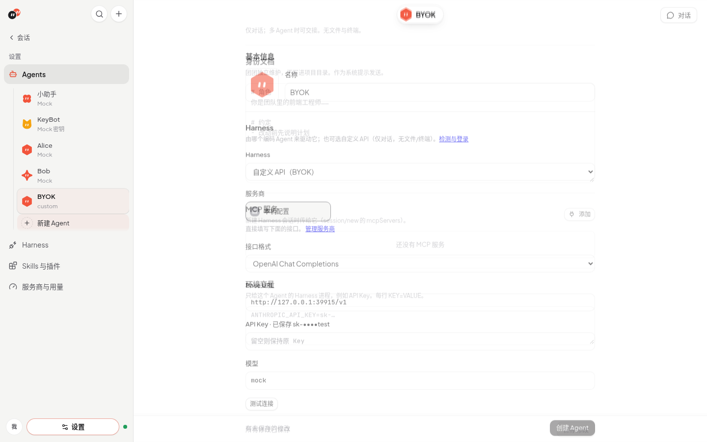
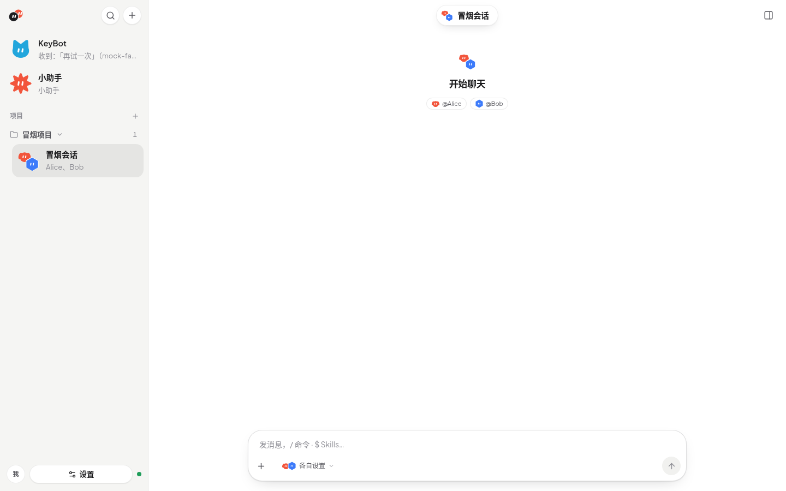
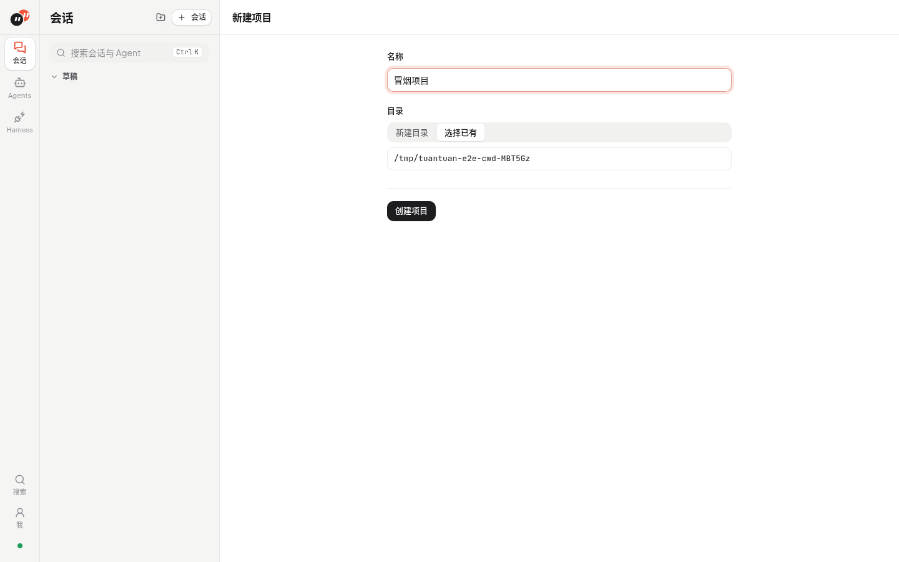
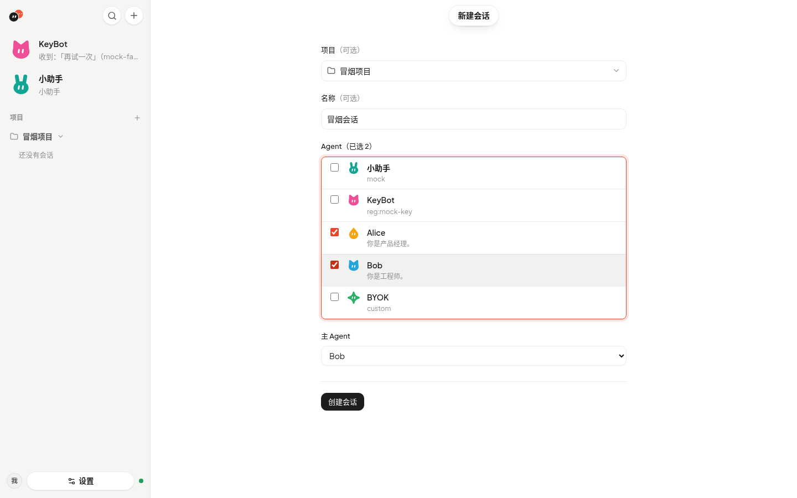
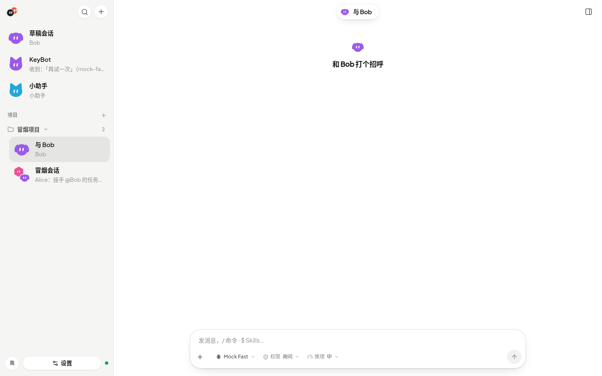

# 界面与视觉

界面截图、视觉风格与 Agent 头像。

## 界面

- 现代简洁风格：干净的中性底色（浅色近白 / 深色石墨），品牌色是 Logo 里的番茄珊瑚红，只用在关键动作和状态上；Agent 头像用鲜亮的彩色区分。字体为 Plus Jakarta Sans（已自托管）+ 苹方，浅色/深色跟随系统。设置开关以当前主题强调色表示开启，关闭和禁用使用中性灰，滑块在深浅主题下均保持清晰。
- Agent 头像是 SVG Bot（11 种可选轮廓 × 13 种颜色，含小猫、小狗、兔子、熊猫、山羊、牛），默认按 Agent id 生成，在编辑页点击头像修改。已保存的旧造型仍可显示和保存。头像会根据状态变表情（思考、说话、难过、惊讶、休眠），开启「减少动态效果」时静止。预览全部表情：`/#/dev/avatars`。

---

[← 返回 README](../README.md) · [文档索引](README.md)
