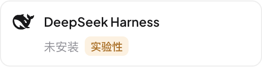
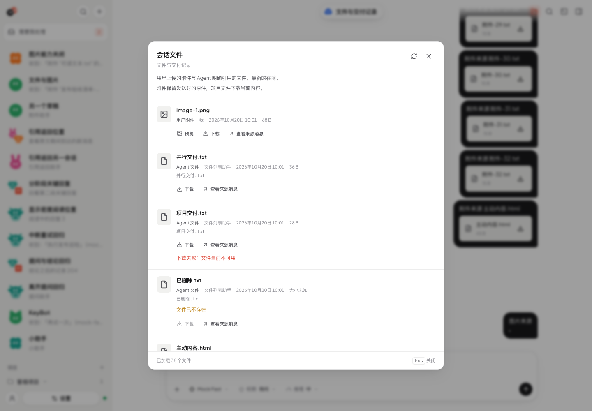
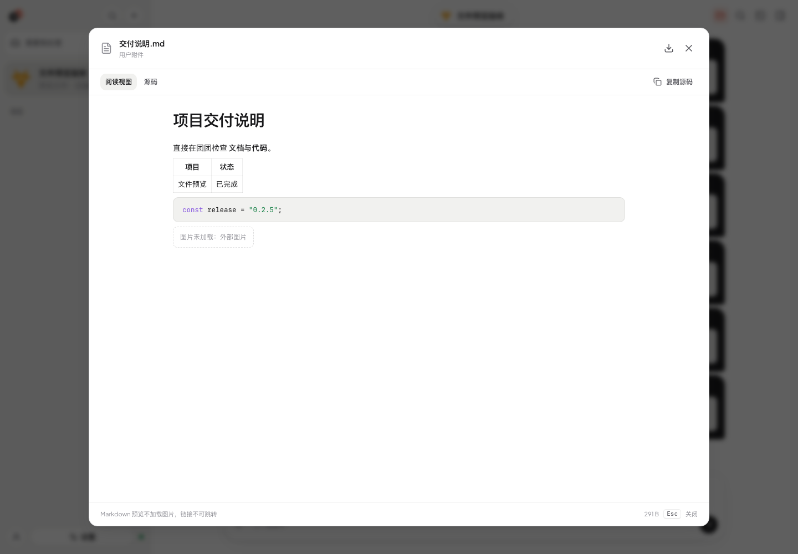
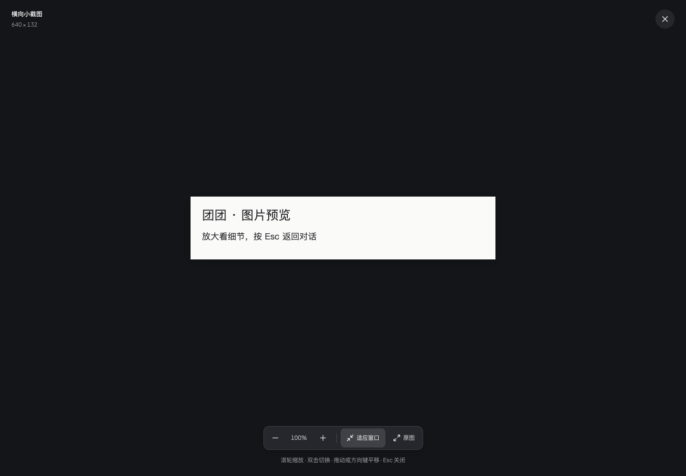
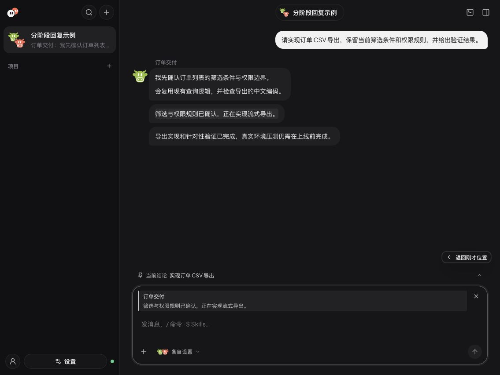

# 界面与视觉

界面语言、截图、视觉风格与 Agent 头像。

## 界面语言

打开侧栏底部「设置」，进入「个人资料」，在「界面语言」选择简体中文、繁体中文、英语或日语。默认简体中文；选择后自动保存，保存成功后切换当前界面，同一本机服务的其他窗口也会同步。保存失败时保留草稿并显示「重试」。桌面菜单和系统通知的应用文案使用同一语言。

语言设置只改变应用文案，不改写聊天、Agent 正文、名称、路径或模型 ID；第三方 Harness 的未知文案与错误保留原文，也不会因此要求模型改用另一种语言回答。状态、按钮、帮助、输入提示及无障碍标签随界面语言更新。

## 模型能力与思考选择

服务商页显示本机目录来源、更新时间及同步入口；搜索只查本地目录，主动点击「同步模型能力」才联网更新。服务商编辑表单的「模型能力来源」默认折叠，展开后可分别关联主模型与快速模型，留空自动识别。

Agent 默认设置和输入框旁的思考选项以 Harness 实际返回为准。「团团推荐」随模型可用能力选择，不覆盖明确保存的设置；切回兼容模型时恢复之前的选择。仅开关能力的 Pi 模型显示「开启」，Claude Code 没有原生关闭选项时不增加按钮。具体边界见 [服务商](providers.md#模型能力目录与思考等级)。

## 界面

侧栏顶部的品牌标识与「需要我处理」「搜索」「新建会话」采用紧凑尺寸（桌面圆形按钮 32×32px，保持标题栏高度、macOS 窗口控制区边界与触屏 44×44px 命中范围），待办数量以角标显示；在会话和设置页均可打开；读取失败或断线时保留已知列表并标记状态。列表优先展示请求类型和原因，整块主要内容可进入来源会话，项目、会话和 Agent 放在次级来源行；失败项提供独立的「从待办移除」按钮，成功移除后焦点接到相邻待办，列表为空时回到标题。授权和提问仍在原会话完成。主要入口和移除操作扩大点击范围，面板与遮罩保留短暂开合过渡，减少动态效果时直接显示。

首次引导的 Harness 卡片按可用宽度调整列数；名称可完整换行，安装状态与「实验性」标记在独立状态行排布，窄屏及较长翻译不会互相覆盖。

搜索弹窗沿用侧栏搜索入口，分为全部会话和当前会话两种范围；结果突出匹配片段并标明来源，空态、加载、失败重试与更多结果在原位显示。点击结果后定位原消息，保留返回阅读位置的入口。⌘K / Ctrl+K 打开全局搜索，聊天中的 ⌘F / Ctrl+F 打开当前会话搜索。

聊天顶部的会话标题以胶囊形态、头像和两层文字标识当前会话：会话名在上，成员或项目在下；运行时下方显示实际任务状态。点击标题打开或收起右侧会话信息，查看回复详情时点击标题会切回会话信息；右侧不另设重复的展开按钮。箭头在鼠标悬停或键盘聚焦时显现，无法悬停的触屏设备保持可见。悬停时胶囊边缘弹性舒展，按下时回缩，标题与头像保持稳定；减少动态效果时边缘保持静止。名称过长时省略显示，悬停可查看完整名称；窄屏保留名称与状态，避免与两侧操作重叠。

聊天顶部「会话文件」打开右侧文件工作台：桌面（`>= 1024px`）与聊天主栏并排停靠，左缘可拖拽或用左右方向键调节宽度，并提供一键「加宽工作台 / 恢复默认宽度」；窄屏覆盖展示，工作台宽度不足双栏时自动切换为列表进入详情、用「文件列表」返回并恢复原行焦点。顶部同级切换「全部文件」「Git 变更」「Agent 改动」「聊天附件」（支持方向键、Home / End），配统一筛选框，列表均按可视区虚拟滚动，在数千文件的项目中保持流畅。目录树按需展开，置灰排后 `node_modules` 等目录，并在文件与文件夹上显示 Git 状态与 Agent 编辑 / 重叠标记；Git 变更以「只读」标签和 `HEAD → 暂存区` / `暂存区 → 工作区` 表达对比范围，支持上一项 / 下一项连续核对并保留刷新前选择与滚动位置；聊天附件保留原件下载、可用状态与「查看来源消息」并排定位。正文中的本地文件链接（工作区内）点击后直接在工作台定位打开，工作区外绝对路径由桌面端交给系统文件管理器。多 Agent 会话在输入区旁显示本会话用量合计，未上报显示「未上报」而非 0。

右侧集成预览区直接呈现选中文件、Git diff 或 Agent 编辑记录，不再叠出二层弹窗。光栅图片内联展示并可点开暗色缩放灯箱；Markdown 默认阅读视图，HTML 默认隔离静态页面，两者均可切换源码；源码显示行号，支持复制、切换自动换行并下载原件。HTML 静态页面不运行脚本或加载外部资源（含外部样式表与背景图）。文本预览上限 1 MiB；文件超过上限、编码不支持或读取失败时保留下载和重试。超过 100 KiB 或 3,000 行的源码使用普通文本，行数过多时关闭换行，避免高亮或逐行布局阻塞阅读。

图片与 Mermaid 图表点击后进入暗色预览，内容直接展示在背景上。顶部保留名称、自然尺寸和关闭入口，底部集中放置缩放比例、放大 / 缩小、适应窗口和原图操作；工具条不遮挡图片。小图保留原始清晰度，长图按窗口完整适配，放大后可拖动查看；窄窗口保留全部核心操作。桌面 macOS 标题区为窗口控制按钮预留位置。

输入框的附件按钮始终可见，统一选择文件与图片。待发送图片显示缩略图，文件显示名称和大小，并提供各自的移除操作；读取、超限和发送失败在输入框附近提示，保留已有草稿。附件条沿用输入框内边距和主题色，窄窗口换行，不挤压模型与发送入口。具体能力与限制见[文件与图片附件](conversations.md#文件与图片附件)。排队中的任务行提供「立即发送」与「编辑消息」两个操作：前者把该消息原地提升为引导，打断同车道当前任务链后优先执行；后者把仍在排队、尚未开始的整条消息从记录中撤回，并把正文、附件与引用放回输入框修改。同车道没有可打断的任务时「立即发送」置灰并说明原因；折叠态单行以铅笔图标提供「编辑消息」，输入框快捷键对唯一排队任务同样走「编辑消息」。规则见[并行与停止](conversations.md)。

聊天主界面围绕用户需要知道的消息组织。精简模式保留各 Agent 的正文与图片，被真实思考或工具记录隔开的正文阶段各自使用主题浅底独立气泡；连续文字、普通换行与相邻图片保留在同一气泡，只有过程没有正文时不生成空气泡。流式追加更新当前气泡，下一段正文出现时才新增气泡，以轻量入场提示变化；减少动态效果时直接显示。同组名字与头像只出现一次，名字与气泡内文字对齐，头像靠上，不增设固定阶段标签，也不把后台工具调用转换成虚构进度。每个气泡有独立的复制与群聊引用入口，只操作当前这段正文；点击消息内或输入框里的引用可定位对应气泡，只有该段正文与图片短暂高亮，完整视图中也保留同一范围。查看原文后可点「返回刚才位置」恢复跳转前的阅读位置，连续查看引用保留最初的返回点；桌面悬停或聚焦时只显示当前气泡的操作栏，窄屏放在各自气泡下方。查看详情和消息 ID 仍对应原始回复。工具、思考、计划、交接记录和任务笔记在「查看详情」中追溯。失败、需要回答的问题和停止操作继续可达。结论与输入框上方的 Agent 回复状态共用一栏：运行中保留状态与结论入口，空闲时显示目标摘要；点击向上浮出非模态详情，消息和输入框保持原位，Escape 或点击外部关闭。来源定位只在目标正文短暂显示中性浅底后淡出，无警示描边。提问默认收成输入框上方的摘要，展开后就地填写，不强制弹窗；少量选项显示为单选行，长表单内部滚动，操作区保持可见。收起保留答案，Tab 可以离开卡片。

多 Agent 协作时，主对话保留群主和直接点名成员的回复；每次请求被委派助手的回复在精简和完整视图中均收进一个默认折叠的「协作详情」。入口叠放参与者头像，运行中的状态以活动指示和强调色标记，失败 / 中断数量保持可见；左侧与头像列同轴的轨道按钮随时收纳 / 展开，展开时竖线标示详情归属，卡片随宽高同步过渡展开，内容随淡入与短位移进场；展开后复用原有消息和工具详情，任务全文、复制及引用均可访问。已交接但未匹配活动任务或回复的分工保留原文并标注「未记录回复」。需要 API Key 的操作保留在折叠区外，授权与提问继续使用原有入口。定位折叠的来源时先展开详情，再定位原文，并可返回先前阅读位置；正文不会被自动改写或另行摘要。

表面使用中性色、清楚的字阶和间距，避免玻璃背景与卡片嵌套。完整视图和详情中的笔记、会话内提问以高度过渡开合；结论浮层使用实底、细边线与轻阴影，以轻微位移和透明度进入、退出，和任务列表互斥，长内容内部滚动。动效可连续反向；减少动态效果时直接切换，来源定位使用静态短暂浅底提示。

「详细/简洁模式」位于右侧会话信息的「详情」中。简洁模式只保留回复正文，详细模式显示完整过程。每个会话单独记住，默认简洁；尚未单独设置的会话沿用本机原来的选择。切换时仅消息区短暂淡入，保留正在阅读的消息，快速反向时恢复原位置。

侧栏可在 272px 列表栏与 64px 图标轨道间收起/展开：顶部「收起/展开侧栏」按钮切换，收起后顶部操作列纵向排列，会话只保留头像与未读角标（悬停显示名称），项目分组标题与正文预览隐藏，底部按钮纵向排列；宽度变化带过渡动画，收起状态记忆在本机。减少动态效果时直接切换。

- 现代简洁风格：干净的中性底色（浅色近白 / 深色石墨），品牌色是 Logo 里的番茄珊瑚红，只用在关键动作和状态上；Agent 头像用鲜亮的彩色区分。字体为 Plus Jakarta Sans（已自托管）+ 苹方，浅色/深色跟随系统。设置开关以当前主题强调色表示开启，关闭和禁用使用中性灰，滑块在深浅主题下均保持清晰。
- Agent 头像是 SVG Bot（11 种可选轮廓 × 13 种颜色，含小猫、小狗、兔子、熊猫、山羊、牛），默认按 Agent id 生成，在编辑页点击头像修改。已保存的旧造型仍可显示和保存。头像保持卡通风格，按下表的「表情 + 动作」组合姿态表达状态；标题岛的空闲头像在悬停或键盘聚焦时呈现好奇表情，工作中的状态优先。预览全部状态：`/#/dev/avatars`。

### Bot 头像状态

状态由 `web/src/avatarState.ts` 统一推导（`avatarState` / `agentActivity` / `roomAvatarState`），绘制在 `BotAvatar.tsx`，动作只在 `styles.css` 的 bot avatar 段落按 `data-expr` / `data-tier` / `data-anim` 定义一次。表情画在共用的脸部层，动作作用在整个头像组上，所以 19 种轮廓行为一致。

| 状态 | 触发 | 表情 | 动作（≥28px） |
| --- | --- | --- | --- |
| 待命 idle | 默认；回复被取消/中断后也回到这里 | 竖眼，偶尔眨眼 | 呼吸（4s），偶尔左右张望 |
| 思考 thinking | 回复等待首字 | 眼睛向上偏 | 头微侧（-6°）+ 慢摇（3.2s），眼神向上漂移 |
| 执行工具 working | 最新一段是进行中的工具调用 | 眯眼看向下方，不眨眼 | 前倾 + 0.9s 有节奏的点头 |
| 输出中 speaking | 流式输出文字 | 张嘴开合（0.6s） | 轻柔弹跳（1.2s） |
| 等你确认 awaiting | 有待批准的权限请求或待回答的问题 | 圆眼直视 + 小微笑 | 挺身，每 2.6s 左右各跳一下招呼你 |
| 完成 happy | 一次运行结束（一次性，约 1.4s） | 笑眼 | 挤压-拉伸跳一下后落定，回到待命 |
| 出错 sad | 最新回复失败 | 下垂眼 + 撇嘴 | 垂头下沉，结束时摇一次 |
| 不可用 sleepy | Agent 绑定的模型不可用 | 闭眼 | 灰色 + 缓慢呼吸（6s） |

- 尺寸分级：≥28px 完整动作；20–24px 只保留表情、眨眼和说话的嘴；≤18px 完全静止，「等你确认」和「出错」加琥珀 / 红色角标。
- 状态切换时姿态过渡 180ms，新表情淡入；只在进行中且可见时循环（离屏、标签页隐藏时暂停）。
- 减少动态效果：保留各状态的姿态和表情，不循环、不过渡。

---

[← 返回 README](../README.md) · [文档索引](README.md)

欢迎页直接提供创建 Agent 或新建会话操作，不重复展示已完成的教学步骤。设置页面以字段、选项和状态标签表达功能，不常驻重复教学段落。个人资料的「提供给 Agent」「Agent 时区」、自定义 API 的仅对话标签、Token 统计的 Harness 上报标签保留必要范围；安装、登录、协议兼容和更新受阻的信息只在相关状态显示。通知分类不再复述名称，桌面专属设置在浏览器中禁用并标识；更新操作按实际安装方式提供检查、下载、重启或手动更新入口。
